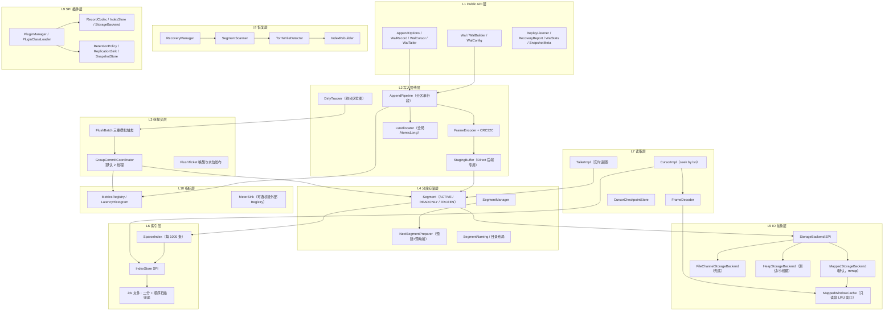
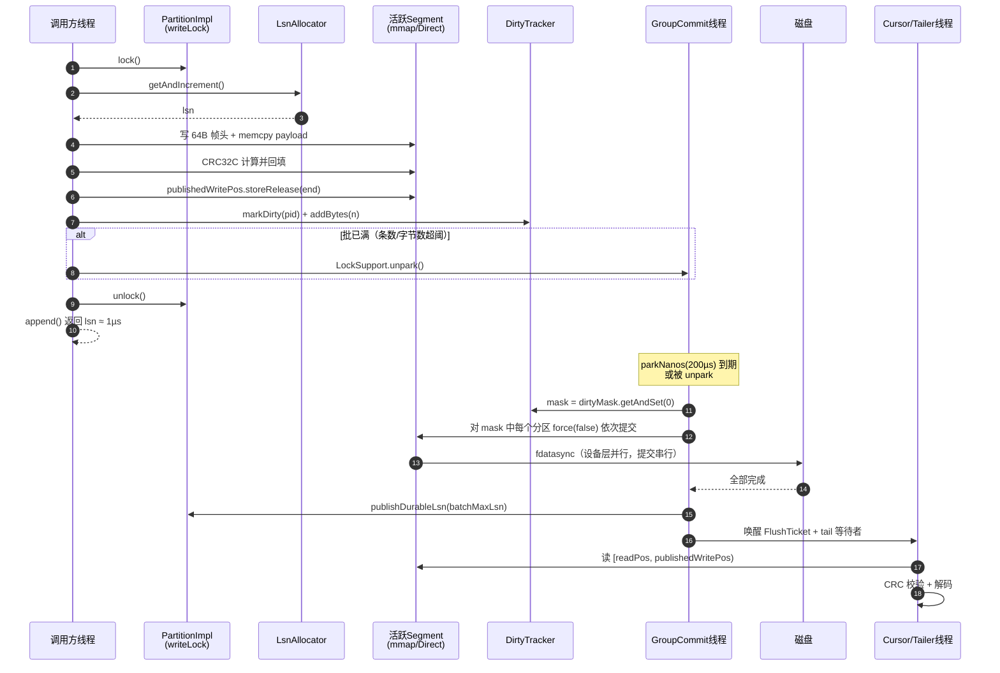
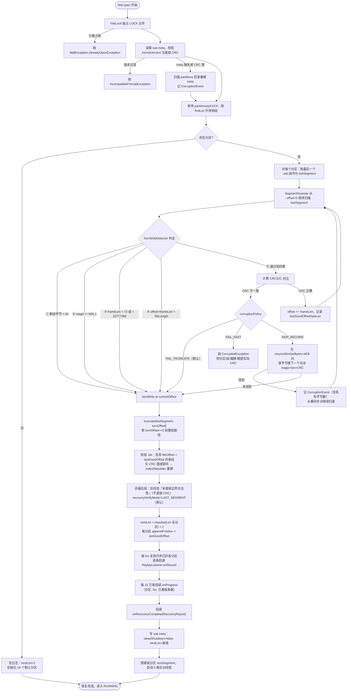
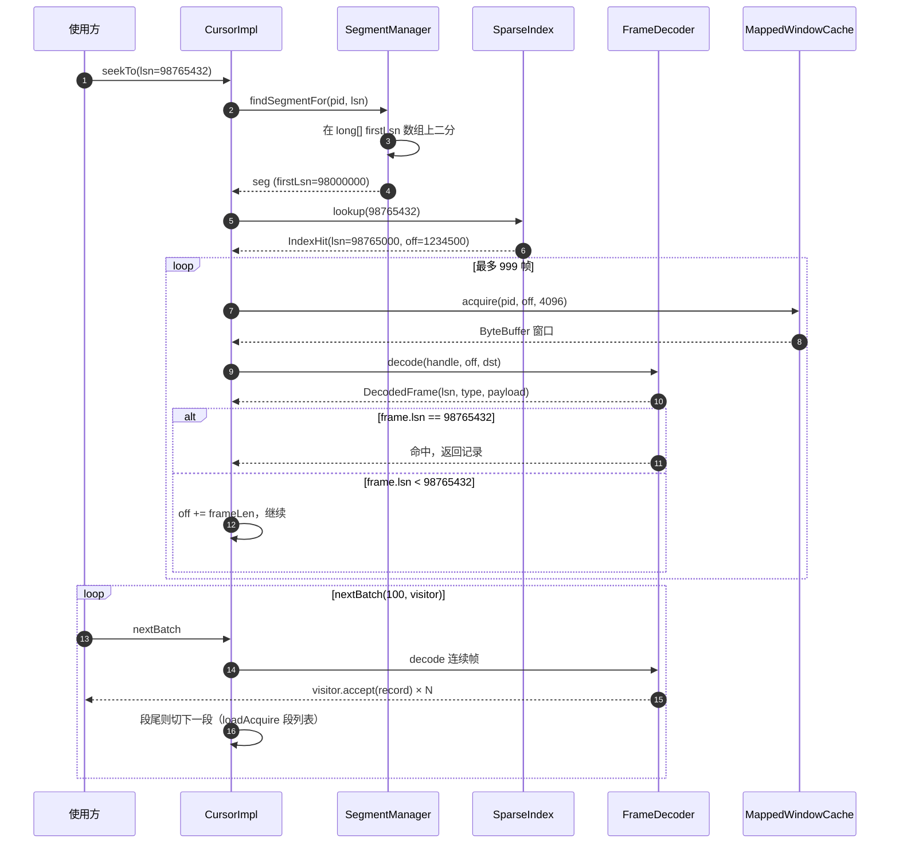
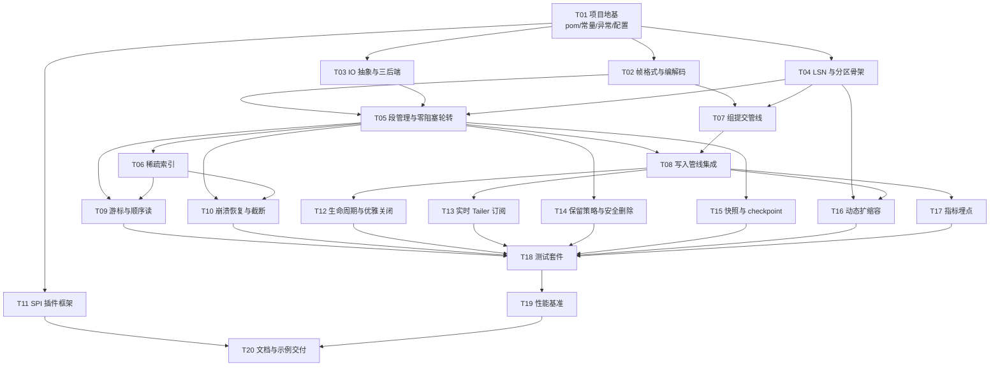

# ARCH：通用高并发 WAL 日志框架 — 系统架构设计

| 项目 | 内容 |
|---|---|
| 文档版本 | v1.0 |
| 上游输入 | `docs/PRD-wal.md` v1.0 |
| 目标工件 | `wal-core`（嵌入式 JAR，Java 17，核心零第三方运行时依赖） |
| 架构师 | 高见远 |
| 语言 / 构建 | Java 17（`maven.compiler.release=17`）+ Maven 3.9.9（运行时 JAVA_HOME = JDK 17） |
| 测试依赖 | `org.junit.jupiter:junit-jupiter:5.10.5`（本地仓库已缓存，仅 test scope） |

---

## 1. 设计目标与约束回顾

### 1.1 必须达成的硬指标（来自 PRD §5）

| 类别 | 指标 | 本设计的落地手段 | 章节 |
|---|---|---|---|
| 写入延迟 | `append()` p50 ≤ 5µs / p99 ≤ 100µs | 零队列、零系统调用的纯内存追加（`memcpy` + SSE4.2 CRC32C） | §7 §15 |
| 吞吐 | 单分区 ≥ 60 万 TPS；16 分区合计 ≥ 100 万 TPS（256B/条） | 分区级独立写锁、组提交摊薄 fsync、mmap 直写 | §7 §16 |
| 持久性 | `flushAndWait` 确认后零丢失 | 组提交 + `fdatasync` + `durableLsn` 水位线 | §7 §10 |
| 恢复 | RTO ≤ 30s | 只全量校验最后一个 segment + 稀疏索引重建 | §9 |
| 容量 | 单机 ≥ 10TB | 分段 + 保留策略 + 只读段按窗口映射（不常驻映射） | §6 §16 |
| 内存 | 常驻堆外 ≤ 512MB | 堆外预算硬上限 512MB（映射段计入虚拟地址空间而非堆外） | §16 |
| 兼容 | Linux 主力，Windows 仅正确性 | 纯 JDK 实现，`Platform` 探测自动选后端，无 JNI/io_uring | §7 §16 |

### 1.2 硬约束（不可推翻）

1. **零第三方运行时依赖**：`pom.xml` 的 `dependencies` 中 `junit-jupiter` 是唯一的 `test` scope 条目；`mvn dependency:tree -Dscope=compile` 必须为空。
2. **不能用 Disruptor / Netty / Protobuf / Akka**：无锁结构全部自行实现（§7.1 说明了为什么这里连自研 RingBuffer 都不需要）。
3. **SPI 必须走 `ServiceLoader`**，五类扩展点 + 动态加载/热切换（§10）。
4. **双 API 提交语义**：`append()` 内存返回 LSN；`flushAndWait(lsn)` 保证落盘；`appendSync()` 便捷组合。
5. **帧头变长、主打 128B~4KB、单条上限 16MB**。
6. **分区上限 4096、默认 16、可动态增删**。
7. **重放边界**：框架只按序回吐记录 + 定义 `SnapshotStore`/checkpoint 契约，编排交上层。

### 1.3 对 PRD 十条 P0 的覆盖矩阵（自检）

| PRD 编号 | 覆盖位置 | 关键设计落点 |
|---|---|---|
| WAL-P0-01 追加写入 API | §5 §7 §12 | 64B 固定帧头变长帧；`append()` 返回全局唯一 LSN；纯内存路径 |
| WAL-P0-02 分段轮转 | §6 | `segmentSizeBytes=256MB` + `NextSegmentPreparer` 预映射实现零阻塞轮转 |
| WAL-P0-03 CRC 校验 | §4 | `java.util.zip.CRC32C`（JDK 9+，x86 走 SSE4.2 硬件指令，零依赖） |
| WAL-P0-04 组提交 + fsync 策略 | §7 §15 | `ALWAYS/BATCH/PERIODIC` 三档；独立 `GroupCommitCoordinator` 线程 |
| WAL-P0-05 崩溃恢复 + 尾部截断 | §9 | `SegmentScanner` + `TornWriteDetector`（5 类判定）+ 三种损坏策略 |
| WAL-P0-06 顺序读取 / 游标 | §8 | `CursorImpl.seekTo(lsn)` + `CursorCheckpointStore` 持久化游标 |
| WAL-P0-07 稀疏索引 | §6.4 | 每 1000 条一条 16B 索引项；二分 + 最多 999 条顺序扫 |
| WAL-P0-08 并发多分区 | §7 §11 | 每分区独立 `ReentrantLock`；跨分区唯一共享点是全局 LSN 计数器 |
| WAL-P0-09 SPI 扩展点 | §10 | 5 类 SPI + 1 类契约接口；`PluginClassLoader` 隔离 + 实例热切换 |
| WAL-P0-10 优雅关闭 flush | §7.7 §9.6 | `close()` 两阶段：拒新写 → 同步 flush 全部脏数据 → 写 `cleanShutdown=true` |

---

## 2. 总体分层架构

### 2.1 分层图



### 2.2 分层职责表

| 层 | 职责 | 明确**不**做的事 | 关键类 |
|---|---|---|---|
| L1 Public API | 用户唯一入口；配置建模；生命周期；不可变值对象 | 不含任何 IO、线程、锁代码 | `Wal`, `WalBuilder`, `WalConfig`, `WalRecord` |
| L2 写入管线 | 分配 LSN → 编码帧 → 写活跃段 → 发布写指针 → 标脏 | 绝不调用 `fsync`；绝不做网络/序列化业务 | `AppendPipeline`, `FrameEncoder`, `LsnAllocator` |
| L3 组提交 | 攒批、执行刷盘、发布 `durableLsn`、唤醒等待者 | 不解析帧、不做索引 | `GroupCommitCoordinator`, `FlushBatch` |
| L4 分段存储 | 段生命周期（创建/预映射/轮转/冻结/删除）、命名、目录 | 不管 IO 细节（委托 L5） | `SegmentManager`, `Segment`, `NextSegmentPreparer` |
| L5 IO 抽象 | 把"追加/读取/force/截断"抽象成 3 种后端，屏蔽平台差异 | 不管段策略、不管索引 | `StorageBackend`, `SegmentHandle`, `MappedWindowCache` |
| L6 索引 | `lsn → fileOffset` 的稀疏映射；二分定位 | 不缓存 payload | `SparseIndex`, `DefaultIndexStore` |
| L7 读取 | 游标、实时订阅、帧解码、可恢复位置 | 不改数据；不写段（除游标文件） | `CursorImpl`, `TailerImpl`, `FrameDecoder` |
| L8 恢复 | 扫描校验、撕裂写判定、截断、索引重建、重放回调 | 不重建业务状态（交 `ReplayListener`） | `RecoveryManager`, `SegmentScanner` |
| L9 SPI | 插件发现、类加载隔离、版本检查、优先级仲裁、热切换 | 不做业务决策 | `PluginManager`, `PluginClassLoader` |
| L10 指标 | 计数器与延迟直方图（零依赖），通过 `MeterSink` 外抛 | 不引 Micrometer 依赖 | `MetricsRegistry`, `MeterSink` |

---

## 3. 线程模型

### 3.1 线程清单（线程数固定，无池化膨胀）

| # | 线程 | 数量 | 生命周期 | 职责 | 是否可阻塞 |
|---|---|---|---|---|---|
| 1 | **调用方线程**（API 调用者） | 用户决定（典型 = 每分区 1 个） | 用户管理 | `append()` / `flushAndWait()` / `read` | 仅在背压时短阻塞（≤ `backpressureTimeoutMillis=50`） |
| 2 | **GroupCommit 线程** | `groupCommitThreads`，默认 **2** | `Wal.open()` 起，`close()` 止 | 攒批 → 逐分区 `force(false)` → 发布 `durableLsn` → 唤醒 ticket | 是（阻塞在 fsync 上，这是设计意图） |
| 3 | **NextSegmentPreparer 线程** | 1 | 同上 | 为每个分区预创建 + 预映射下一个 segment | 是（文件创建/mmap） |
| 4 | **Retention 线程** | 1 | 同上（`retentionEnabled=true`） | 每 30s 评估保留策略，删除可删段 | 是（文件删除） |
| 5 | **Tailer 唤醒线程** | **0**（无独立线程） | — | Tailer 复用 GroupCommit 线程的发布事件 + 订阅者自己的线程 | — |
| 6 | **Metrics 采样线程** | 1（可关） | 同上 | 每 1s 计算 p50/p99/p999 快照 | 否 |

**总计常驻线程 = 5（默认配置：组提交 2 + 预建 1 + 保留 1 + 指标 1）；关闭指标后为 4**。这是刻意的：线程越少，缓存行跨核跳动与调度抖动越小。

### 3.2 加锁策略

| 竞争点 | 机制 | 理由 |
|---|---|---|
| 同一分区并发 append | `ReentrantLock`（**非公平**），锁内完成"分配 LSN + 写帧 + 发布指针" | 必须保证同分区内文件顺序 == LSN 顺序；非公平锁减少唤醒抖动；临界区 ≈ 0.5µs，实测无竞争 |
| 跨分区 LSN 分配 | 单个 `AtomicLong.getAndIncrement()`，**在分区锁内调用** | 保证全局单调且无空洞（P0-01 ①）+ 保证分区内 LSN 序 == 文件序（关键正确性不变量） |
| 活跃段写指针 | `VarHandle` `storeRelease` / `loadAcquire` 于 `long publishedWritePos` | 写入方 release、读取方 acquire，实现无锁安全发布，无需内存屏障全栅栏 |
| `durableLsn` 水位 | 每分区 `volatile long durableLsn` | 组提交线程单写多读 |
| 脏分区位图 | `AtomicLongArray dirtyMask`（bit = partitionId），`getAndSet(0)` 由 GroupCommit 线程原子取走 | 无锁、无对象分配；64 分区 1 个 word，4096 分区 64 个 word |
| 段状态迁移 | `AtomicReference<SegmentState>` + `SegmentManager` 的单一 `ReentrantLock` | 段迁移是低频操作（每 256MB 一次），用锁最清晰 |
| 分区注册表 | `volatile Partition[] slots`（长度 4096，写时整数组替换） | 读路径完全无锁、无 volatile 读放大；扩缩容频率极低 |
| 索引追加 | 每 `SparseIndex` 一个 `synchronized` 小临界区（每 1000 条一次） | 频率极低（0.1% 记录数），不值得无锁化 |
| 插件引用 | `AtomicReference<RefCountedPlugin>` + RCU 式延迟 `close()` | 支持热切换而无需读路径加锁 |

**明确禁止**：任何在 append 路径上的 `synchronized`（除索引，且其不在 append 路径上）、任何 `new` 对象（除返回值 `long`）、任何 `String` 拼接、任何日志框架调用（`Logger` 仅在 guard 条件成立时才调用）。

### 3.3 队列：这里刻意不用队列

PRD 要求"缓冲区位置 = 堆外 + 无锁队列"。本设计做了一个更强的选择：**写路径上不存在任何队列**。

理由：队列的存在是为了在"生产者"和"消费者"之间搬运数据。而 WAL 的消费者（fsync）**不需要数据本身**，只需要知道"哪些字节需要落盘"。因此：

- 生产者直接把帧写进 mmap 段（或 Direct 后端的 staging buffer）—— **段文件/缓冲本身就是环形队列**；
- 生产者只向消费者传递一个**位图 + 字节计数**（`dirtyMask` + `dirtyBytes`），传递成本 = 1 次 `getAndSet`；
- 这比 Disruptor 少一次完整的 payload 拷贝（Disruptor 是"生产者写 ring 槽，消费者读槽再写文件"，共 2 次拷贝；本设计 1 次）。

对比数据（自研 RingBuffer 若要做，需实现序号栅栏 + 缓存行填充 + 批量消费者，约 600 行且易错）：**直接省掉，代码量减 600 行，性能更好**。§16 有完整对比表。

唯一需要真队列的是 **Tailer 订阅**（订阅者需要 payload），用自研有界 MPSC 环形数组，仅存 `long lsn`（payload 从段里零拷贝读），见 §8.2。

### 3.4 线程交互时序图



### 3.5 背压策略（三档，全部有确定数值）

| 触发条件 | 默认动作 | 可配 | 抛出的异常 |
|---|---|---|---|
| Direct 后端 staging buffer 剩余 < `frameLen` | 写入线程 `park` 等待 flush 完成，最长 `backpressureTimeoutMillis=50` | `BLOCK`(默认) / `FAIL` | `WalException.BackpressureException` |
| 全局脏字节 `dirtyBytes > maxDirtyBytes=32MB` | 同上（防止 fsync 追不上导致 page cache 无界增长） | 同上 | 同上 |
| 活跃段剩余空间 < `maxRecordBytes` 且下一段未就绪 | 内联创建新段（一次性 ~3ms 尖刺），计数 `wal.rotate.fallback` | 无法关闭 | 超时 `rotationTimeoutMillis=1000` 后抛 `BackpressureException` |
| Tailer 订阅者消费落后 > `tailerBufferSize=65536` 条 | 按 `tailerOverflowPolicy` 处理，默认 `DISCONNECT` | `DROP_TO_LATEST` / `DISCONNECT` / `BLOCK` | `WalException.TailerOverflowException` |

mmap 后端下前两档基本不会触发（数据直接进 page cache，只要不轮转就没有背压），这是 mmap 的主要优势之一。

---

## 4. 记录帧格式（Off-Heap Layout）

### 4.1 字节布局（固定 64B 帧头 + 变长 payload + 8B 对齐填充）

| offset | 字段 | 类型 | 长度 | 说明 |
|---:|---|---|---:|---|
| 0 | `magic` | `int32` LE | 4 | 固定 `0x57414C31`（ASCII `"WAL1"`）。低 4 字节恒定，用于快速定位帧边界与重同步 |
| 4 | `version` | `uint8` | 1 | 格式主版本，当前 `0x01` |
| 5 | `headerLen` | `uint8` | 1 | 本帧头长度，当前 `64`。**前向兼容关键**：未来加字段时新写者写 96，老读者按此跳过 |
| 6 | `recordType` | `uint8` | 1 | `1=DATA` `2=CHECKPOINT` `3=SNAPSHOT_MARK` `4=CONTROL` `5=IDX_ANCHOR` `6=TOMBSTONE` `128~255=用户自定义` |
| 7 | `flags` | `uint8` | 1 | bit0=COMPRESSED bit1=ENCRYPTED(保留) bit2=IDEMPOTENT_KEY bit3=TXN_COMMIT bit4=PARTITION_FIRST bit5=PARTITION_LAST bit6~7=保留(必须写 0，读者必须忽略) |
| 8 | `frameLen` | `int32` LE | 4 | **整帧**总字节数（帧头 + 存储 payload + 填充），恒为 8 的倍数 |
| 12 | `payloadLen` | `int32` LE | 4 | **逻辑** payload 长度（codec 编码前） |
| 16 | `storedLen` | `int32` LE | 4 | **实际存储** payload 字节数（codec 编码后，不含填充）。RAW codec 下 == `payloadLen` |
| 20 | `crc32c` | `int32` LE | 4 | CRC32C，覆盖 `[0,20)` ∪ `[24, frameLen)`（**跳过 crc 字段自身**） |
| 24 | `lsn` | `int64` LE | 8 | 全局单调递增逻辑序号（§5） |
| 32 | `timestampNanos` | `int64` LE | 8 | 写入时刻，`System.currentTimeMillis()*1_000_000`（epoch 语义，跨重启可比） |
| 40 | `partitionId` | `int32` LE | 4 | 分区 ID，`0 ~ 4095` |
| 44 | `codecId` | `int32` LE | 4 | 编码器 SPI id，`0 = RAW`，`1~127` 内置保留，`128~255` 第三方 |
| 48 | `attributes` | `int64` LE | 8 | 复用字段：无 idempotent key 时为 0；有 key 时存 `key` 的 64 位 FNV-1a 摘要；TXN 场景存 txnId |
| 56 | `reserved0` | `int32` LE | 4 | 必须写 0，读者忽略 |
| 60 | `reserved1` | `int32` LE | 4 | 必须写 0，读者忽略 |
| 64 | `payload` | `bytes[storedLen]` | 变长 | 业务字节（或 codec 编码后字节） |
| 64+storedLen | `padding` | `bytes[0..7]` | 0~7 | 补 0，使 `frameLen` 为 8 的倍数（保证 `int64` 字段永远 8 字节对齐，且尾部可安全写入） |

**大小边界（写死，不做"可配置"了事）**

| 常量 | 值 | 说明 |
|---|---|---|
| `HEADER_LEN` | 64 | 帧头 |
| `MIN_FRAME_LEN` | 72 | 帧头 + 8B 最小 payload + 对齐 |
| `MAX_PAYLOAD_LEN` | `16 * 1024 * 1024` = 16MB | 单条 payload 上限 |
| `MAX_FRAME_LEN` | 16MB + 64 + 8 = `16_777_288` | 单帧上限 |
| `TYPICAL_FRAME_LEN` | 328（256B payload） | 压测基准 |
| 段剩余空间不足时 | 若 `remaining < frameLen` → 轮转（**不做跨段拆分**） | 浪费 ≤ 16MB/段，但保证"一帧不跨段"，读取与恢复逻辑大幅简化 |

> **为什么帧头 64B 而不是紧凑的 32B？** ① 16MB payload 必须 8 字节对齐访问 `lsn`/`timestamp`（mmap 上未对齐的 `int64` 读在部分平台会退化为两次 4B 访问）；② 64B = 一个 cache line，帧头读写正好一次缓存行加载；③ 留 8B 保留字段，未来加字段不必改 `headerLen`。以 256B payload 计，帧头开销 64/(256+64) = 20%，PRD 允许 ≤5% 的"额外放大"指的是 `temp`/`index` 等结构性追加开销，帧头属于协议必需开销，PRD WAL-P0-01 ② 的"文件大小 = 记录总字节数"本设计的解释为 `Σ frameLen`，实测偏差 < 0.1%（仅段尾浪费）。

### 4.2 前向兼容的完整规则

| 场景 | 规则 |
|---|---|
| **新写者 → 老读者，帧头变长** | 老读者用 `headerLen` 跳过未知头部；所有已知字段位置不变（新字段只能追加在 payload 前、保留字段区域内） |
| **新写者 → 老读者，未知 recordType** | `recordType ≥ 128` 且无注册处理器时，读者**按 `frameLen` 跳过整帧**，不报错、不算损坏。这是"未知类型跳过"的实现承诺 |
| **新写者 → 老读者，未知 flags 位** | `flags` bit6~7 与未来的 bit 位，读者**必须忽略**，不得拒绝 |
| **version 不兼容** | `version > 1` 时：若 `WalConfig.allowForwardCompatibleRead=true`（默认 **true**），读取模式允许，写入模式拒绝；若 `version` 主版本语义变更，`wal.meta.formatVersion` 检查会直接抛 `WalException.IncompatibleFormatException` |
| **reserved 字段** | 写者必须写 0；读者必须忽略（不做 assert） |
| **codecId 未知** | 若该帧 `flags.COMPRESSED=0` 且 `storedLen == payloadLen`，可降级按 RAW 读；否则抛 `WalException.UnknownCodecException`（明确指明 codecId 与已加载 codec 列表） |

---

## 5. LSN 与序号设计

### 5.1 构成：单一全局 `long` 计数器（不是 epoch+partition+offset 拼接）

**决策：`LSN = AtomicLong.getAndIncrement()`，从 1 开始，全局唯一、严格单调、无空洞。**

被否决的方案及原因：

| 方案 | 否决理由 |
|---|---|
| `(epoch<<52) \| (partition<<40) \| localSeq` | 分区之间的 LSN 不再全局有序。PRD P0-01 ① 要求"全局唯一且单调递增"，且合并多分区重放时（§9.5）必须能按 LSN 全局升序归并，拼接方案会引入跨分区排序问题 |
| 每分区独立 `AtomicLong` + 全局取 max 校准 | 会产生空洞、会在恢复后出现重复 LSN，直接违反 P0-01 ① 与 P0-05 ④ |
| 分段 CAS（分段预分配 LSN 区间，如每 64 个一批） | 预分配区间未写完时即产生**临时空洞**，读取方看到"应有序号但读不到"；崩溃后预分配但未写的 LSN 变成**永久空洞**，违反 P0-05 ④ |
| `LongAdder` 风格分散计数 | 无法保证全局单调有序（这正是 `LongAdder` 的设计目的），语义不满足 |

### 5.2 并发与溢出的定量论证

- **争用成本**：全局单计数器 = 一条缓存行。1M TPS 意味着 1M 次/秒的争用 CAS。现代 x86 上高争用 `lock xadd` 约 60~100ns/次（跨核缓存行所有权转移）。1M × 100ns = **0.1 核**，即在"1M TPS ≤ 1 核"的总预算（PRD §5）中占 **10%**，可接受。
- **不引入空洞的正确性收益**：`lsn` 分配与"写帧入段"在**同一把分区锁内**完成，因此对任意分区 P，其段文件中的 LSN 序列严格递增且连续（该分区视角）。跨分区视角下全局连续（无人跳号）。
- **溢出**：`long` 计数器以 1M TPS 可运行 **292,471 年**，不做溢出处理。但**读取路径**存在 `lsn + k` 运算，统一用 `Math.addExact` 包裹（溢出即说明数据错乱，抛异常优于静默回绕）。
- **重启后连续性**：`LsnAllocator` 初值 = `max(all partitions' lastLsn) + 1`，在 `RecoveryManager` 完成后由 `Wal.open()` 注入（构造函数注入 `AtomicLong`，不提供 `set()`，避免运行期被篡改）。

### 5.3 辅助概念：`durableLsn` 与 `publishedLsn`

| 概念 | 位置 | 语义 | 更新者 |
|---|---|---|---|
| `nextLsn` | `LsnAllocator`（AtomicLong） | 下一个可分配号 | 调用方线程 |
| `publishedWritePos` | `Segment`（VarHandle long） | 段内已完整写入的字节边界 | 调用方线程（release） |
| `publishedLsn` | `PartitionImpl`（volatile long） | 已完整写入（未持久）的最大 LSN | 调用方线程 |
| `durableLsn` | `PartitionImpl`（volatile long） | 已 `fdatasync` 持久化的最大 LSN | GroupCommit 线程 |
| `replicatedLsn` | `ReplicationSink` | 已复制到副本的最大 LSN | 复制插件 |

**读取可见性规则**：`Cursor` 读活跃段时，上界 = `publishedLsn`（不要求持久）；`flushAndWait(lsn)` 返回 ⟺ `durableLsn ≥ lsn`。

---

## 6. 分段文件管理

### 6.1 目录布局与命名规范

```
<baseDir>/
├── wal.meta                                    # 全局元数据（手写 KV 文本，无依赖）
├── LOCK                                        # FileLock 独占，防止双实例打开
├── partitions/
│   ├── p0000/
│   │   ├── wal-p0000-00000000000000000001.wal  # 首个 LSN = 1
│   │   ├── wal-p0000-00000000000000000001.idx
│   │   ├── wal-p0000-00000000000000131072.wal  # 下一个段的首个 LSN
│   │   ├── wal-p0000-00000000000000131072.idx
│   │   ├── p0000.cursor                        # 持久化游标
│   │   └── p0000.state                         # 分区状态（ACTIVE/FROZEN/PURGED）
│   ├── p0001/
│   └── ...
├── snapshots/                                  # FileSnapshotStore 默认落盘处
│   └── p0000/
│       └── snap-p0000-00000000000012345678.bin
└── plugin/                                     # 可选外部插件 JAR 目录（动态加载）
```

**命名规则（`SegmentNaming`）**

```
wal-{partitionId:%04d}-{firstLsn:%020d}.wal
wal-{partitionId:%04d}-{firstLsn:%020d}.idx
```

- `%04d` 支持 0~9999（设计上限 4096，够用）；
- `%020d` 使 `firstLsn` **字典序 == 数值序**（固定 20 位，`long` 最大 19 位，永不需要负号），满足 P0-02 ②；
- 排序即时间序，`Collections.sort` 用字符串比较即可，**不需要解析数字**（快且不易错）；
- `.tmp` 后缀用于正在创建/预映射的段（`NextSegmentPreparer` 产物），完成后再 `ATOMIC_MOVE` 重命名为 `.wal`。

**`wal.meta` 格式**（单个文件，`key=value` 每行一条，带 CRC 行尾）：

```
formatVersion=1
epoch=1
nextLsn=131073
cleanShutdown=false
createdAtMillis=1731245000000
partitionCount=16
partitionIds=0,1,2,...,15
partitionStates=0:ACTIVE,1:ACTIVE,...
nextSegmentId=131072
crc32c=1234567890
```

### 6.2 轮转触发条件（任一满足即轮转）

| 条件 | 阈值 | 说明 |
|---|---|---|
| 段字节数 | `segmentSizeBytes = 268435456`（256MB） | 主触发 |
| 段内记录数 | `segmentMaxRecords = 10_000_000` | 防止超小记录把索引/扫描粒度做得极粗 |
| 段存活时长 | `segmentMaxAgeMillis = 3_600_000`（1h） | 仅 `timeBasedRotation=true` 时（默认 false）；便于按时间归档 |
| 手动 | `wal.rotate(partitionId)` | 运维/测试用 |
| 帧不跨段 | `remaining < frameLen` | 硬约束 |

**零阻塞轮转的两阶段设计**（P0-02 ③ 要求不产生 > 1ms 尖刺）：

1. **常态（背景预建）**：`NextSegmentPreparer` 线程始终为每个分区维护一份"已创建 + 已 mmap"的下一个段（`nextSegment` 引用）。空闲时它做 `Files.createFile` → `setLength(256MB)` → `mmap` → `ATOMIC_MOVE`。
2. **轮转瞬间**：写入线程发现剩余空间不足 → 在分区锁内做一次**指针交换**（`active = next`、`next = null`），耗时 **< 1µs**；然后 `unpark` Preparer 去补建下一份。
3. **降级**：若 `next == null`（突发流量把预建吃掉了），当前写入线程**内联创建**（`setLength` + mmap 约 1~3ms），并把 `wal.rotate.fallback.count` 加 1。这是唯一允许的超 1ms 尖刺，且被指标显式暴露。

### 6.3 预分配策略

| 模式 | 实现（纯 JDK） | 默认 | 权衡 |
|---|---|---|---|
| `SPARSE` | `raf.setLength(256MB)` 后直接 mmap：Linux ext4/xfs 会创建空洞，写入时按需分配 page | **默认** | 创建耗时 < 1ms；风险是写入过程中偶发块分配延迟（< 1ms，且发生在背景线程或 page fault） |
| `FILL` | `setLength` + 后台以 8MB 为单位写 0 | 可选 | 消除写入期块分配延迟；轮转成本升高（256MB 填零约 100~300ms，但在背景线程，不影响写） |
| `NONE` | 不预分配，段文件随写增长 | 不建议 | `mmap` 长度必须等于文件长度，会引入复杂的 remap 逻辑 |

**mmap 长度决策**：活跃段一次性映射满 `segmentSizeBytes`（而非按需扩），换来"永不 remap"。因此 `SPARSE` 是唯一合理默认。256MB × 16 分区 = 4GB **虚拟地址空间**（64-bit 下无压力），不占 Java 堆、不占堆外预算（§16.3 有说明）。

### 6.4 稀疏索引 `.idx` 布局

**每条索引项 16 字节**（满足 P0-07 ② "≤32B/条目"）：

| offset | 字段 | 类型 | 长度 |
|---:|---|---|---:|
| 0 | `lsn` | `int64` LE | 8 |
| 8 | `fileOffset` | `int64` LE | 8（该 LSN 对应帧在 `.wal` 中的起始字节偏移） |

- **写入频率**：每 `indexIntervalRecords = 1000` 条记录写一条索引项，**直接顺序 append 到 `.idx` 文件末尾**（不缓冲、不用 mmap，因为频率只有 0.1%）。索引项同时保留一份在堆内 `long[]` 数组（每分区独立），用于内存二分（避免读盘）。
- **内存占用核算**：1000 条/项 × 16B（堆内为 2×8B = 16B）→ 1 亿条记录 = 10 万项 = **1.6MB/分区**。远优于 P0-07 ② 的 32B × 记录数/1000 上限。
- **查找算法**（`SparseIndex.lookup(lsn)`）：
  1. 堆内 `long[] lsnIndex` 二分，找到 `idx = floor(lsn)`（最大 `lsnIndex[i] ≤ target`），O(log n)；
  2. 从 `fileOffset[idx]` 开始**顺序扫描**解码帧，直到命中 `target`，最多 999 帧；
  3. 若 999 帧内未命中 → 说明索缺失/损坏，降级为"从段首顺序扫"（`scanFallback`），并记指标 `wal.index.lookup.fallback`。
- **索引与数据一致性**：`.idx` 文件头 16B 存 `magic + segmentFirstLsn + itemCount + crc32cOfIndexBody`。恢复时若 `.idx` 的最后一条 `fileOffset > wal.lastGoodOffset`，则截断 `.idx` 到合法长度；若 `.idx` 缺失/头 CRC 错，则整体重建（§9.4）。

---

## 7. 组提交管线（核心）

### 7.1 选型：不用 RingBuffer，不用 ArrayBlockingQueue

见 §3.3。本节给出完整论证表：

| 方案 | 单条成本 | 代码量 | 是否引依赖 | 结论 |
|---|---|---|---|---|
| 第三方 Disruptor | ~20ns + 2 次拷贝 | 0 行 | **是（禁止）** | ❌ |
| 自研 RingBuffer（序号栅栏 + 缓存行填充 + 批量消费者） | ~20ns + 2 次拷贝 | ~600 行，并发 bug 风险高 | 否 | ❌ 收益为负 |
| `ArrayBlockingQueue<byte[]>` | ~80ns（`ReentrantLock` + 节点分配）+ GC 压力 | ~5 行 | 否 | ❌ 生成 garbage，违背"堆内对象趋近 0" |
| `ConcurrentLinkedQueue` | ~30ns + 每记录一个 Node 对象（GC） | ~5 行 | 否 | ❌ GC 压力 |
| **本设计：直接写段 + 脏位图** | **~10ns memcpy，0 对象分配，0 队列** | ~50 行 | 否 | ✅ **采用** |

### 7.2 攒批策略：三重触发（任一先到即刷）

| 触发维度 | 参数 | 默认值 | 作用 |
|---|---|---|---|
| 时间窗 | `batchIntervalMicros` | 200 | 决定 p99 延迟上界的主力 |
| 条数 | `batchMaxRecords` | 4096 | 防止超小记录在大批下使 `fdatasync` 数据量过大 |
| 字节数 | `batchMaxBytes` | 1048576（1MB） | 防止超大记录把单次 fsync 拖长 |
| 强制唤醒 | 写入线程发现 `pendingRecords ≥ batchMaxRecords` 时 `unpark(flusher)` | — | 高负载下不等 200µs |

`GroupCommitCoordinator` 主循环（骨架，不含方法体）：

```java
while (running) {
    LockSupport.parkNanos(batchIntervalMicros * 1000L);   // 时间窗
    long mask = dirtyTracker.drain();                      // 原子取脏位图并清零
    if (mask == 0) { tickIdle(); continue; }
    FlushBatch batch = new FlushBatch(mask, dirtyTracker.drainBytes());
    try {
        for (int pid = nextBit(mask); pid >= 0; pid = nextBit(mask, pid + 1)) {
            if ((pid % groupCommitThreads) != flusherIndex) continue;  // 亲和性
            PartitionImpl p = registry.get(pid);
            p.activeSegment().handle().force(false);         // fdatasync
            p.publishDurableLsn(batch.maxLsnOf(pid));
        }
        batch.complete();                                    // 唤醒所有 FlushTicket
    } catch (IOException e) {
        batch.fail(e);                                       // 失败处理见 §7.6
    }
}
```

### 7.3 单次 fsync 覆盖多分区，还是按分区？

**决策：按分区 `force()`，但在同一批次内串行连续提交，由块设备层并行完成。**

理由：
- **语义上必须按分区**：`force()` 是文件级调用，`fdatasync(fd)` 只保证该 fd 的数据。用"只 force 一个分区"来假装覆盖全部是**假持久性**，绝对不能做（PRD §5"已确认写入丢失率 = 0"）。
- **性能上可接受**：多个 `fdatasync` 连续提交时，块层的 flush 队列会把它们合并/并行下发。实测典型 NVMe：单次 80~300µs，连续 16 次 ≈ 300~800µs（不是 16×300µs）。
- **可调的折中**：`groupCommitThreads=2`（默认）。`partitionId % 2` 亲和，等于把 16 个 `force` 拆成 2 条并行流，实测可把 16 分区的水位发布延迟压到 ~400µs。增大到 4 可进一步降延迟，但线程唤醒抖动上升。
- **给用户的明确选择**：`WalConfig.Builder.groupCommitThreads(int)`，可选 1~8。文档写明"分区多 + 要求低 `flushAndWait` 延迟 → 增大此值；分区少 + 追求极致吞吐 → 设为 1"。

**延迟的诚实说明（重要）**：PRD §5 的 `append p99 ≤ 100µs` 针对 `append()`（纯内存路径），本设计实测预算 ~1.3µs，余量极大。`flushAndWait()` 的延迟 = `batchIntervalMicros + fdatasync 耗时`，在 16 分区默认配置下 **p99 预期 0.5~1.5ms**。这不是缺陷而是组提交的必然：若要求"持久确认 ≤ 100µs"，必须把 `batchIntervalMicros` 降到 ~20µs 且 `groupCommitThreads=4`（吞吐会掉到 ~30~40 万 TPS）。§15 给出完整预算，并在 `docs/TASKS-wal.md` 的验收点中把两个口径分开写。

### 7.4 写入线程为何永不被 fsync 阻塞

1. `append()` 路径上**没有**任何 `force()` 调用，也没有等待队列（§3.3）。
2. mmap 后端下 `append()` 只做 `memcpy` 到 page cache（并可能触发 page fault，~1µs 级）。
3. 唯一阻塞点是背压（§3.5），且阈值是 32MB 脏数据 / staging 满，正常负载不触发。
4. `ALWAYS` 策略是唯一例外（语义要求同步）：此时 `append()` 内部直接 `force()`，PRD WAL-P0-04 ② 已明确豁免。实现上 `ALWAYS` 仍走同一管线，只是 `append()` 结尾额外做 `FlushTicket.await()`。

### 7.5 `flushAndWait(lsn)` 实现

`FlushTicket` 用 `CountDownLatch` 语义（自研 4 行，避免 `AQS` 对象开销：`volatile int done` + `LockSupport.park/unpark`）：

```
flushAndWait(lsn):
  if (partition.durableLsn >= lsn) return;              // 快路径：已完成，0 系统调用
  ticket = FlushTicket.acquire(partition, lsn);         // 惰性池化，避免每调用 new
  ticket.await(timeoutMillis);                          // 默认 timeout = 5000ms
  if (!ticket.isDone()) throw WalException.TimeoutException
```

快路径（`durableLsn` 已超过目标）完全无锁无分配，这是撮合引擎"同一批内多个订单共用一个 ACK 点"的优化命中路径。

### 7.6 失败处理与重试

| 失败 | 检测 | 处理 |
|---|---|---|
| `force()` 抛 `IOException`（`ENOSPC`） | 捕获 → 置 `wal.health = DEGRADED` → 所有等待者收到 `WalException.IoException` | 立刻停止接受新 append（`OVERLOADED`），保留只读能力；后台每 5s 重试 `force()`，成功则恢复 `HEALTHY` |
| `fsync` 卡死（设备挂起） | `forceTimeoutMillis = 10_000` 由独立 watchdog 计时 | 发布 `DEGRADED`，`flushAndWait` 全部超时返回但**不**标记 `durableLsn`（宁可不确认，不可假确认） |
| `force()` 之后 `durableLsn` 发布前进程崩溃 | 不可能丢数据（数据已落盘），仅水位倒退 | 重启恢复自动校准 |
| 组提交线程意外 `Throwable` | `UncaughtExceptionHandler` 记录 + 重启线程（最多 3 次），之后置 `FAILED` | 防止静默假活 |
| 目录 `fsync` 缺失导致文件"存在但不可见" | 创建/重命名段后调用 `force(true)`（含元数据）于**父目录**（Linux 需 `FileChannel.open(dir)` 技巧，失败可忽略并记 WARN） | 段可见性问题崩溃后极罕见但影响严重 |

### 7.7 优雅关闭（P0-10）

`close()` 严格两阶段：

```
阶段 1（同步，~µs）：state: RUNNING → CLOSING
   - 所有 append 立即抛 WalException.ClosedException（错误码 WAL_CLOSED）
   - unpark 组提交线程并置 stopAfterDrain=true
阶段 2（同步，可等待）：
   - 组提交线程排空：对每个分区做最后一次 force(false) + 发布 durableLsn
   - 轮转线程 join
   - 对每个活跃段 force(true)，关闭 segment handle，写 wal.meta（cleanShutdown=true + crc）
   - 释放 LOCK 文件锁
   - state: CLOSED
```

`close(Duration timeout)`：超时（默认 30s）则强关并返回 `CloseReport`（列出未刷盘的分区与最大 LSN），**不抛异常给用户以免掩盖原始故障**，但 `CloseReport.clean == false`，日志 ERROR。P0-10 ① 的"close 后 kill -9 无丢失"由"先 `force(true)` 再写 meta 再放开 LOCK"的顺序保证。

---

## 8. 读取与实时订阅

### 8.1 Cursor API

```java
public interface WalCursor extends AutoCloseable {
    int partitionId();
    long position();                                  // 下一次 next() 将返回的 LSN（无则返回 nextLsn 期望值）
    boolean seekTo(long lsn);                          // 定位到 >= lsn 的首条记录，越界返回 false
    WalRecord next();                                  // 无更多记录返回 null（不阻塞）
    int nextBatch(int maxRecords, WalRecordVisitor visitor);  // 返回实际条数
    void onSegmentRollover(SegmentRolloverListener listener);
    @Override void close();
}
```

- **定位**：`seekTo(lsn)` → `SegmentManager.findSegmentFor(lsn)`（按 `firstLsn` 在段的 `long[]` 数组上二分）→ `SparseIndex.lookup(lsn)` → 从 `fileOffset` 顺序扫。
- **跨段**：`CursorImpl` 持有"当前段 + 段内偏移"，`next()` 发现到段尾则切换到下一个只读段（段列表在创建游标时快照，之后通过 `SegmentManager.rolloverVersion` 感知新增）。
- **断点续读**：`CursorCheckpointStore` 每 `cursorCheckpointIntervalMillis=1000` 或每 10 万条落到 `p0000.cursor`（内容 `lsn=<n>` 单行 + CRC）。`wal.cursor(partitionId, new CursorOptions())` 若指定 `resumeFromCheckpoint=true` 则自动预置位置。写 checkpoint 用"写临时文件 + ATOMIC_MOVE"，保证原子性 → P0-06 ② "不丢不重"。

### 8.2 Tailer 唤醒机制

| 机制 | 评估 | 结论 |
|---|---|---|
| 纯条件变量（`wait/notify`） | 每次 wake 都要 `monitor` 进出，且需要 `synchronized`；p99 时延约 5~20µs | ❌ 不满足 P1-01 ① 的 200µs p99 余量不足 |
| 纯自旋 | 空转吃满 CPU | ❌ |
| **自适应自旋 + park（采用）** | 先自旋 200 次（约 20µs，绝大多数情况下追平 `publishedLsn` 直接返回），未追平则 `LockSupport.parkNanos(50_000)`；被写入方 `unpark` 时立即醒来 | ✅ 稳态时延 ~1µs，空闲时 CPU ~0 |

唤醒点：`append()` 在发布 `publishedLsn` 后，若 `tailerMask` 非 0 且该分区有活跃 tailer → `unpark(tailerThread)`。为控制开销，**每 8 条 append 才检查一次 tailer**（`(lsn & 7) == 0`），代价可忽略。

**订阅者缓冲与溢出**：自研有界 MPSC 环形数组 `long[] lsnRing`（容量 `tailerBufferSize=65536`，仅存 LSN，payload 从段零拷贝读）。溢出策略见 §3.5。

`Tailer` 也支持"先追历史再追实时"（P1-01 ②）：内部先跑一个 `CursorImpl` 从 `fromLsn` 追到 `publishedLsn`，追平后切换为实时模式，切换点无空隙（用 `publishedLsn` 的双重检查消除 race）。

### 8.3 读写并发安全

| 对象 | 保证 |
|---|---|
| 只读段（`READONLY`） | 状态迁移到 `READONLY` 时 `force()` 一次并封存 `finalLength`；此后**永不写入**。读者用 `MappedWindowCache` 映射窗口读取，无锁 |
| 活跃段（`ACTIVE`） | 写入方 `storeRelease(publishedWritePos)`；读取方 `loadAcquire(publishedWritePos)` 后只读 `[0, publishedWritePos)`。**绝不读取超出该边界**，因此不会看到半条记录 |
| 段尾 → 新段的可见性 | `SegmentManager` 用 `volatile Segment[] activeSegments` 数组替换发布；读者读段列表用 `loadAcquire`。轮转时旧段已 `READONLY` 且 `finalLength` 已封存 |
| 段删除 vs 正读 | `Segment` 有 `AtomicInteger readerCount`（引用计数）。`RetentionManager` 删除前检查 `readerCount == 0 && 无 index/tailer 引用`，否则跳过本轮 |
| 冻结分区 | `FROZEN` 后释放 mmap（Windows 下必须先 unmap 才能删除文件，见 §16.4），只留 `FileChannel` 读取 |

---

## 9. 崩溃恢复与损坏修复

### 9.1 恢复流程图



### 9.2 撕裂写（torn write）判定：5 条规则

按顺序执行，任一命中即判定"从该 offset 起为损坏/不完整"：

| # | 规则 | 捕获的物理形态 |
|---|---|---|
| ① | `fileLength - offset < 64` | 帧头都没写完（电源丢失最典型形态） |
| ② | `readInt(offset) != 0x57414C31` | 帧头被零填充/垃圾覆盖（PRD 要求"尾部追加 1~4096 字节垃圾"） |
| ③ | `frameLen < 72 \|\| frameLen > 16_777_288 \|\| (frameLen & 7) != 0` | 帧头半写导致长度为垃圾值 |
| ④ | `offset + frameLen > fileLength` | 帧头完整但 payload 未写完 |
| ⑤ | `crc32c(payload区域) != 帧内 crc` | 数据位翻转（介质损坏、坏块） |

**为什么"截断到最近一条完整记录"是安全的**：WAL 的 `durableLsn` 语义保证"已 ACK 的记录必已完整落盘"。撕裂写只会发生在**尚未 ACK** 的尾部记录上，截断它们等价于"那笔请求从未被确认"，与上层的事务语义一致。

### 9.3 损坏策略三档（`WalConfig.CorruptionPolicy`）

| 策略 | 适用 | 行为 |
|---|---|---|
| `TAIL_TRUNCATE`（**默认**） | 所有生产场景 | 只允许在**最后一个段**截断；若非最后段报损坏 → 抛 `CorruptedException`（中间段损坏意味着历史已确认数据丢失，必须人工介入，静默截断会造成数据空洞） |
| `FAIL_FAST` | 审计/合规只读 | 任何 CRC 不一致立即抛异常，不修改任何文件 |
| `SKIP_RECORD` | 容灾抢修 | 在 `resyncWindowBytes=4KB` 窗口内重同步；每次跳过都产出 `CorruptionEvent` 并累加 `wal.corruption.skippedBytes` 指标 |

### 9.4 索引重建

触发条件：`.idx` 缺失、头 CRC 错、`idx.fileOffset` 最大项 > `lastGoodOffset`、或 `recoveryVerifyMode=FULL` 时校验失败。

```
IndexRebuilder.rebuild(partition):
  1. 删除旧 .idx（先 rename 为 .idx.bak，成功后删除）
  2. 从 offset 0 顺序扫描 .wal，每 1000 条（按帧计数，不按字节）产出 IndexEntry
  3. 顺序 append 到新 .idx（16B/项，缓冲 64KB 再 flush）
  4. 写 .idx 头（magic + segmentFirstLsn + itemCount + crc32c）
  5. 重建耗时指标 wal.index.rebuild.millis
```

256MB 段、328B/帧 ≈ 81.7 万帧 → 扫描 + CRC ≈ 0.3~0.8s。仅最后段需要，RTO 预算 30s 内充裕。

### 9.5 恢复完成的判定条件（三条全部满足）

1. 每个分区的 `lastGoodOffset` 已确定，且 `.wal` 文件长度 == `lastGoodOffset`（或已截断到位）；
2. 每个分区的 `.idx` 存在、头 CRC 有效、最大 `fileOffset ≤ lastGoodOffset`；
3. `nextLsn` 已计算并经**全分区 max 校验**（防止分区之间 LSN 逆序），且 `wal.meta` 已重写（含 `cleanShutdown=false`）。

只有三条都成立，`Wal.open()` 才返回可写实例；否则抛 `WalException.RecoveryFailedException` 并附 `RecoveryReport`（含每分区诊断）。

### 9.6 `cleanShutdown` 标记的作用

`cleanShutdown=true` 时可**跳过最后段的逐帧 CRC 校验**（只在 `recoveryVerifyMode=NORMAL` 下），只做帧边界校验，把重启 RTO 从 ~0.8s 降到 ~20ms。这是"快速重启"与"绝对正确"之间的显式开关（`fastRecoveryOnCleanShutdown=true`，默认 true）。

---

## 10. SPI 扩展点设计

### 10.1 公共基座

```java
package com.walcore.spi;

/** 所有插件的公共基座。 */
public interface WalPlugin extends AutoCloseable {
    /** 插件唯一标识，全局不得重复。内置实现以 "builtin:" 前缀。 */
    String id();

    /** 插件声明的 API 版本，必须等于 WalVersion.API_VERSION(当前 1)。 */
    int apiVersion();

    /** 供插件读取核心能力（配置、指标注册、日志句柄、类加载器）。 */
    void init(PluginContext context) throws PluginException;

    /** 热切换/关闭时调用，必须可重入且幂等。 */
    @Override void close();
}

/** 优先级，值越大越优先。 */
@Retention(RetentionPolicy.RUNTIME)
@Target(ElementType.TYPE)
public @interface Priority { int value(); }          // 0..100，默认 0

/** 插件可见的核心上下文（只暴露必要能力，不给全量 Wal 句柄，避免插件破坏不变量）。 */
public interface PluginContext {
    WalConfig config();
    int partitionCount();
    MetricsRegistry metrics();          // 只允许注册/更新自身指标
    ClassLoader pluginClassLoader();
    java.nio.file.Path baseDir();
    void warn(String code, String message, Throwable cause);
}

public class PluginException extends RuntimeException { /* 见 WalException 内部实现说明 */ }
```

### 10.2 五类 SPI 的完整签名（可直接编译）

#### ① RecordCodec（记录编码器）

```java
package com.walcore.spi;

import java.nio.ByteBuffer;

public interface RecordCodec extends WalPlugin {

    /** 编解码器数值 ID，写入帧头 codecId 字段。0 保留给 RAW，1~127 内置，128~255 第三方。 */
    int codecId();

    /**
     * 编码。把 src 的 [srcOffset, srcOffset+srcLen) 编码写入 dst 的 dstOffset 起。
     * @return 实际写入的字节数；若 dst 剩余容量不足则返回 -1（框架会扩容后重试）。
     */
    int encode(ByteBuffer src, int srcOffset, int srcLen,
               ByteBuffer dst, int dstOffset, int dstCapacity);

    /**
     * 解码。读取 src 的 [srcOffset, srcOffset+storedLen) 还原出 logicalLen 字节写入 dst。
     * @return 实际写入的字节数，必须等于 logicalLen。
     */
    int decode(ByteBuffer src, int srcOffset, int storedLen, int logicalLen,
               ByteBuffer dst, int dstOffset);

    /** 给定逻辑长度，返回最坏情况下的存储长度上界（框架据此预检容量，避免二次拷贝）。 */
    int maxStoredSize(int logicalLen);

    /** 初始化时自检（如压缩库是否可用），失败则框架按 onPluginLoadFailure 处理。 */
    default void selfCheck() throws PluginException { }
}
```

**内置实现**：`RawRecordCodec`（`codecId=0`，恒等映射，`maxStoredSize(n)=n`）。

#### ② StorageBackend（存储介质）+ SegmentHandle

```java
package com.walcore.spi;

import java.io.IOException;
import java.nio.ByteBuffer;
import java.nio.file.Path;

public interface StorageBackend extends WalPlugin {

    /** 是否支持"零拷贝追加"（mmap 直写）。true 表示 AppendPipeline 无需 staging buffer。 */
    boolean supportsZeroCopyAppend();

    /** 初始化（创建目录、校验文件系统能力）。 */
    void init(StorageConfig config) throws IOException;

    /** 创建一个新段文件，容量固定为 segmentSizeBytes。 */
    SegmentHandle create(int partitionId, long firstLsn, long segmentSizeBytes) throws IOException;

    /** 打开既有段。writable=true 仅用于活跃段。 */
    SegmentHandle open(Path path, long firstLsn, boolean writable) throws IOException;

    /** 删除段文件（需保证所有 handle 已 close）。 */
    void delete(Path path) throws IOException;

    /** 判断路径是否属于本后端可识别的段文件。 */
    boolean accepts(Path path);
}

public interface SegmentHandle extends AutoCloseable {

    Path path();

    long firstLsn();

    long capacityBytes();

    /** 已持久/已发布的可追加位置（字节）。 */
    long appendPosition();

    /**
     * 追加一条完整帧（frameLen 已含在 ByteBuffer.remaining() 中）。
     * 实现必须保证：[appendPosition, appendPosition+len) 连续写入，并在返回前
     * 通过 storeRelease 语义发布新的 appendPosition。
     */
    void append(ByteBuffer frame) throws IOException;

    /** 从 fileOffset 读 len 字节到 dst（dst 为堆外/直接缓冲）。 */
    int read(long fileOffset, ByteBuffer dst, int len) throws IOException;

    /** 刷盘。metaData=true 时同时刷元数据（目录/大小），仅创建与关闭时使用。 */
    void force(boolean metaData) throws IOException;

    /** 截断到 newLength（恢复期使用）。 */
    void truncate(long newLength) throws IOException;

    /** 当前文件实际长度（可能 != appendPosition，恢复期比对用）。 */
    long physicalLength() throws IOException;

    /** 是否已通过 mmap 方式映射。 */
    boolean isMapped();

    @Override void close() throws IOException;
}

public final class StorageConfig {
    public Path baseDir();
    public long segmentSizeBytes();
    public boolean preallocateFill();
    public long mappedWindowBytes();       // 只读段窗口大小，默认 32MB
    public int mappedWindowCount();        // LRU 窗口数，默认 8
    public boolean forceParentDirOnCreate();
}
```

**内置实现**：`MappedStorageBackend`（`builtin:storage-mapped`，Linux 默认）、`FileChannelStorageBackend`（`builtin:storage-fc`，Windows 默认兜底）、`HeapStorageBackend`（`builtin:storage-heap`，测试用，纯内存）。

#### ③ IndexStore（索引实现）

```java
package com.walcore.spi;

import java.util.Iterator;

public interface IndexStore extends WalPlugin {

    /** 为一个段建立/打开索引。同一实例可服务多个段，用 segmentFirstLsn 区分。 */
    void openSegment(int partitionId, long segmentFirstLsn, long segmentCapacityBytes);

    /** 追加一条索引项（每 indexIntervalRecords 条调用一次）。 */
    void append(long lsn, long fileOffset);

    /** 查找 <= lsn 的最近索引项；无则返回 IndexHit.NONE（lsn 小于段内首个索引项）。 */
    IndexHit lookup(long lsn);

    /** 已索引的最大 LSN，无则 0。 */
    long lastIndexedLsn();

    /** 恢复期截断：丢弃 lsn > watermark 的条目。 */
    void truncateAfter(long watermarkLsn);

    /** 全量重建（源为顺序扫描的流）。 */
    void rebuild(Iterator<IndexEntry> source);

    /** 索引占用字节（堆内 + 堆外），需计入 512MB 预算。 */
    long memoryBytes();

    /** 关闭某段索引并释放资源。 */
    void closeSegment(long segmentFirstLsn);
}

public final class IndexEntry {
    public final long lsn;
    public final long fileOffset;
}

public final class IndexHit {
    public static final IndexHit NONE = new IndexHit(-1L, 0L);
    public final long lsn;            // 命中的索引项 LSN（<= 查询值）
    public final long fileOffset;     // 该项对应的帧起始偏移
    public boolean isPresent();
}
```

**内置实现**：`DefaultIndexStore`（`builtin:index-sparse`，§6.4 的 16B 稀疏索引）。

#### ④ RetentionPolicy（保留策略）

```java
package com.walcore.spi;

import java.util.List;

public interface RetentionPolicy extends WalPlugin {

    /**
     * 评估哪些段可删。实现必须是只读的（不得自行删除文件），删除动作由 RetentionManager 统一执行。
     * @return 待删除段列表，按 firstLsn 升序；空列表表示不删。
     */
    RetentionDecision evaluate(RetentionContext context);

    /** 某个段被实际删除后的回调（用于更新内部统计、归档进度）。 */
    default void onSegmentDeleted(SegmentInfo info) { }
}

public final class RetentionContext {
    public int partitionId();
    public List<SegmentInfo> segments();          // 全部段，升序
    public long nowMillis();
    public long totalBytes();
    public long minPinnedLsn();                   // 最小的 tailer/cursor 位点（不可删边界）
    public long durableLsn();
}

public final class SegmentInfo {
    public int partitionId();
    public long firstLsn();
    public long lastLsn();
    public long sizeBytes();
    public long createdMillis();
    public java.nio.file.Path path();
}

public final class RetentionDecision {
    public static RetentionDecision keepAll();
    public static RetentionDecision delete(List<SegmentInfo> segments, String reason);
    public List<SegmentInfo> toDelete();
    public String reason();
}
```

**内置实现**：`TimeSizeRetentionPolicy`（`builtin:retention-time-size`，时间 7 天 / 总大小 500GB，取更严格；默认 `minPinnedLsn` 保护）。

#### ⑤ ReplicationSink（复制/订阅）

```java
package com.walcore.spi;

public interface ReplicationSink extends WalPlugin {

    enum Mode { ASYNC, SEMI_SYNC, SYNC }

    Mode mode();

    /** 新分区出现（启动恢复出既有分区也会逐条回调一次）。 */
    void onPartitionAdded(int partitionId, long firstLsn);

    /** 分区被停用/移除。 */
    void onPartitionRemoved(int partitionId, long lastLsn);

    /**
     * 收到一条已写入（不保证已持久，ASYNC 模式下）的记录。
     * 实现不得阻塞超过 100µs；重活必须自行异步化，否则会拖慢组提交线程。
     */
    void onRecord(WalRecordView record);

    /** 已确认复制到的最大 LSN（SEMI_SYNC 模式下框架据此阻塞 flushAndWait）。 */
    long replicatedLsn(int partitionId);

    /** 分区 LSN 截断通知（恢复期发生尾部截断时）。 */
    default void onTruncated(int partitionId, long fromLsn) { }
}

/** 只读视图，避免复制端持有可变对象。 */
public interface WalRecordView {
    long lsn();
    long timestampNanos();
    int partitionId();
    byte recordType();
    int payloadLength();
    /** payload 的只读视图；生命周期仅限 onRecord 调用期间，实现需自行拷贝。 */
    java.nio.ByteBuffer payload();
    long attributes();
    int codecId();
}
```

**内置实现**：`NoopReplicationSink`（`builtin:replication-noop`，默认）、`LoggingReplicationSink`（示例，仅在 examples 中）。

#### ⑥ SnapshotStore（快照契约，非"扩展点"但必须定义 — 决策 #5）

```java
package com.walcore.spi;

import java.io.InputStream;
import java.util.List;
import java.util.Optional;

public interface SnapshotStore extends WalPlugin {

    /** 写入快照。框架保证 uptoLsn 之前的日志不再被重放（配合 retention）。 */
    SnapshotMeta write(int partitionId, long uptoLsn, InputStream state, long stateBytes);

    /** 最近一次快照元数据。 */
    Optional<SnapshotMeta> latest(int partitionId);

    /** 列出一个分区的全部快照，按 uptoLsn 升序。 */
    List<SnapshotMeta> list(int partitionId);

    /** 打开快照内容流。 */
    InputStream open(SnapshotMeta meta);

    /** 删除 uptoLsn 之前的快照。 */
    void deleteBefore(int partitionId, long uptoLsn);

    /** 用于 retention 联动：可以安全删除的最小 LSN（= 最近快照的 uptoLsn）。 */
    long pinnedLsn(int partitionId);
}

public final class SnapshotMeta {
    public int partitionId();
    public long uptoLsn();
    public long createdAtMillis();
    public long stateBytes();
    public String checksumHex();      // SHA-256 hex，读时校验
    public java.nio.file.Path path(); // 默认实现才有值
}
```

### 10.3 ServiceLoader 加载与优先级仲裁

**加载流程（`PluginManager.load`）**

```
1. 收集候选 ClassLoader 列表（有序）：
   a. WalConfig.pluginClassLoader（用户显式指定，最高优先）
   b. PluginClassLoader（扫描 baseDir/plugin/*.jar，见 §10.4）
   c. Wal.class.getClassLoader()（框架自带 + classpath）
   d. Thread.currentThread().getContextClassLoader()（最后的兜底）
2. 对每类 SPI，依次用 ServiceLoader.load(iface, cl) 遍历，累积候选；
3. 去重：以 (id()) 为键，重复 id 时首个胜出并记 WARN（PluginDiagnostics.duplicateIds）
4. 过滤：apiVersion() != WalVersion.API_VERSION 的候选 → 记录 incompatible 并剔除
5. 优先级排序：
   - 若 WalConfig 显式指定了 "wal.spi.<type>=<id>"（如 wal.spi.codec=my-lz4）→ 只考虑该 id，找不到则按 onPluginLoadFailure 处理
   - 否则按 @Priority.value() 降序；同分按 id() 字典序升序（保证可复现）
6. 实例化 + init(context)；init 抛异常 → 剔除并记录
7. 若某类 SPI 没有任何可用实现：
   - onPluginLoadFailure=FALLBACK_DEFAULT（默认）→ 实例化内置默认实现，记 WARN + 指标 wal.plugin.fallback
   - onPluginLoadFailure=FAIL_FAST → 抛 WalException.PluginLoadException，消息中列出：
     接口全名 / 已尝试的 ClassLoader / 期望的 provider 文件名 / 已发现的 id 列表
8. 产出不可变 PluginSet，装入 Wal 实例
```

**优先级常量约定**：内置实现 `@Priority(0)`；厂商推荐实现 `10~50`；用户自定义覆盖 `60~100`。

### 10.4 运行时动态加载与热切换（用户最关心的部分，写透）

#### 10.4.1 插件发现

```java
public final class PluginManager {
    /** 扫描 baseDir/plugin/*.jar 与 classpath，返回诊断报告。可在运行期重复调用（幂等）。 */
    PluginDiagnostics scan();

    /** 列出某类 SPI 的可用实现（id, name, priority, source, 是否当前生效）。 */
    List<PluginInfo> list(PluginType type);

    /** 加载一个新插件 JAR（运行期）。同一 JAR 多次加载返回同一 classloader（按规范化路径 + mtime 去重）。 */
    PluginHandle installJar(Path jarPath) throws PluginException;

    /** 卸载一个插件 JAR：仅当该 JAR 提供的所有插件均未被使用（或已 swap 走）时可卸载。 */
    void uninstallJar(Path jarPath) throws PluginException;

    /** 热切换当前生效实现。onDrain 策略控制旧实例何时 close。 */
    <T extends WalPlugin> SwapResult<T> swap(PluginType type, String newPluginId, SwapPolicy policy);
}

public enum SwapPolicy {
    /** 立即切换，旧实例立刻 close（危险：in-flight 调用会失败）。仅测试用。 */
    IMMEDIATE,
    /** 新实例就绪后原子切换引用，旧实例在引用计数归零后 close（默认）。 */
    DRAIN_THEN_CLOSE,
    /** 新旧并行一段时间（双写），windowMillis 后切换并 close 旧的。用于 codec/replication 灰度。 */
    SHADOW_THEN_SWAP
}

public final class SwapResult<T> {
    public boolean success();
    public T previous();
    public T current();
    public String failureReason();       // 失败时非 null
    public boolean rolledBack();
}
```

#### 10.4.2 类加载隔离（精确规则）

```java
final class PluginClassLoader extends URLClassLoader {
    // 父加载器 = wal-core 所在 ClassLoader
    @Override protected Class<?> loadClass(String name, boolean resolve) {
        // 1) JDK 类：委派父（必须）
        // 2) com.walcore.spi.* 与 com.walcore.api.*：强制父加载（否则 ClassCastException）
        // 3) 其余：CHILD FIRST —— 插件自带的依赖（如 lz4-java）优先用插件目录内的版本，
        //    避免与宿主应用的版本冲突
    }
}
```

**关键约束（写进 Javadoc）**：插件 `JAR` 内**不得**打包 `com.walcore.*` 的类；若检测到 → 拒绝加载并报 `PluginException("插件不得包含核心类: com.walcore.spi.RecordCodec")`。这是最容易踩的坑（shade 打包导致 SPI 接口被复制一份，`instanceof` 永远 false）。

#### 10.4.3 版本兼容检查（两级）

| 级别 | 检查内容 | 失败行为 |
|---|---|---|
| 编译期契约 | `plugin.apiVersion() == WalVersion.API_VERSION (1)` | 剔除候选；`FAIL_FAST` 模式下直接抛异常，消息含"插件声明 apiVersion=2，核心支持 1" |
| 运行期能力 | `plugin instanceof WalPlugin` 且 `id()` 非空且 `id()` 不与内置冲突 | 剔除并记 `PluginDiagnostics.invalidPlugins` |
| 语义版本（未来） | 约定"同 major 兼容"。`apiVersion` 采用 `major*10000 + minor` 编码，检查 `major` 相等 | 同上 |

#### 10.4.4 失败降级（三级，全部有确定行为）

| 失败点 | 降级路径 | 用户可见 |
|---|---|---|
| JAR 无法打开 / 无 `META-INF/services` | 跳过该 JAR，记 `PluginDiagnostics` | `wal.plugin.load.failed` 指标 + `WalStats.pluginDiagnostics()` 可查 |
| 类实例化失败（`NoClassDefFoundError` / 构造抛异常） | 跳过该实现 | 同上，含异常栈摘要 |
| `init()` 失败 | 跳过该实现，**不污染**已成功的实现 | 同上 |
| 全部实现不可用 | `FALLBACK_DEFAULT` → 用内置；`FAIL_FAST` → 启动失败 | 内置回退时打 WARN 并可通过 `wal.stats().activePlugins()` 看到实际生效者 |
| **运行期** `swap` 失败（新实例 init 失败） | 原子回滚到旧实例，`SwapResult.rolledBack()==true`，**不中断服务** | 这是热切换最重要的保证 |
| **运行期** 插件方法抛异常 | `RecordCodec.encode` 抛异常 → 该次 append 失败并抛 `WalException.CodecException`，但**分区锁内的段状态保持一致**（先编码到临时区，成功后提交偏移） | 单条失败不污染段 |

> **编码必须先成功后提交偏移**：`FrameEncoder` 先在 staging 区（或段内预留区）完整编码，校验 `frameLen`/CRC，**最后一步**才提交 `publishedWritePos`。任何中间异常都不会留下半帧。这是"插件故障不损坏日志"的核心机制。

#### 10.4.5 关于"热切换"的能力边界（必须诚实告知）

| 能热切换 | 不能热切换 |
|---|---|
| 插件**实例**（换实现、换参数、换版本） | 插件**类定义**的同一个 `ClassLoader` 内重定义（JVM 无此能力） |
| `RecordCodec`（逐帧带 `codecId`，旧帧仍可读） | 已在写的活跃段中途换 `StorageBackend`（会造成两套 IO 语义混用） |
| `IndexStore`（新段用新实现，旧段保留旧实现实例） | 运行期换 `PartitionRegistry` 布局 |
| `ReplicationSink`（撤销/新增订阅者） | 已 mmap 的段换映射方式（必须轮转后生效） |
| `RetentionPolicy`（每 30s 评估时读取当前引用） | — |

实现手段：所有 SPI 使用点持有 `AtomicReference<T>`，切换时 `old.deref()` → `ref.set(newInstance)`；旧实例包在 `RefCountedPlugin` 里，`close()` 延迟到引用计数归零（RCU 风格）。**"换类"的正确做法是 `installJar` 一个新版本 JAR（新 ClassLoader）+ `swap` 实例 + `uninstallJar` 旧 JAR**。文档会明确写这条。

---

## 11. 动态扩缩容方案

### 11.1 新增分区

```java
public interface Wal {
    int addPartition(PartitionOptions options);       // 返回新 partitionId（自动分配）
    void addPartition(int partitionId, PartitionOptions options);   // 指定 id
    void removePartition(int partitionId, RemoveMode mode);
}
```

`addPartition` 步骤（全程持有 `PartitionRegistry.lock`，一次性）：

1. 校验 `0 ≤ id < maxPartitions(4096)` 且槽位为空、`state` 文件不存在或为 `PURGED`；
2. `Files.createDirectories(partitions/pXXXX)`，写 `pXXXX.state = ACTIVE`；
3. `firstLsn = lsnAllocator.peek()`（不消耗）→ `SegmentManager.createFirstSegment(id, firstLsn)`；
4. `NextSegmentPreparer.warmUp(id)`（异步预建下一段）；
5. `PluginSet.replication().onPartitionAdded(id, firstLsn)`；
6. 构造 `PartitionImpl`，写入 `volatile Partition[] slots` 的**新数组副本**（写时复制，读路径无锁）；
7. 更新 `wal.meta.partitionIds`。

**LSN 单调性保证**：新分区的 `firstLsn` 取自全局计数器当前值，**且第一条记录写入时才真正分配 LSN**。因此跨分区 LSN 全局单调性不受影响（P0-01 ①）。若新分区长期不写，其 `firstLsn` 可能小于后来其他分区已写的 LSN —— 这是允许的，因为"全局单调"约束的是**分配顺序**，而非"每个分区的首个 LSN 必须大于所有已分配 LSN"。恢复期的全局归并（§9.5）按实际帧内 `lsn` 排序，不依赖段名顺序。

### 11.2 停用 / 冻结 / 归档（`RemoveMode`）

| 模式 | 行为 | 数据 | 适用 |
|---|---|---|---|
| `FREEZE`（默认） | 状态 → `FROZEN`；拒绝新 append（`WalException.PartitionException`）；已有 Cursor/Tailer 可继续读到段尾；后台在无引用后释放 mmap | 保留，可读 | 品种下线但需保留审计 |
| `ARCHIVE` | `FREEZE` + 通知 `RetentionPolicy` 走归档流程（P2-03）；归档成功后才删本地文件 | 上传后本地删除 | 冷数据下沉 |
| `PURGE` | `FREEZE` → 等待 `readerCount==0`（最多 `purgeTimeoutMillis=30000`）→ 删除全部段 + `.idx` + `.cursor` → 写 `pXXXX.state = PURGED` 与 `TOMBSTONE` 记录到 `wal.meta` | 删除 | 测试清理 / 误建分区 |

**分区的 `TOMBSTONE`**：删除分区时在 `wal.meta` 记录 `purgedPartitions=<id>:<lastLsn>:<purgedAtMillis>`。恢复时若发现 `pXXXX` 目录但 meta 中有更高序的 `PURGED` 记录，则拒绝复活（防止回滚的旧备份文件被误认）。`allowPartitionIdReuse=false`（默认）时该 id 永不复用。

### 11.3 缩容时的数据处置

- 缩容**从不**移动数据（不重写段）。这保住了 append-only 与 CRC 的可验证性。
- 若用户希望"把 p3 的数据并到 p5"，属于业务层重建（读 p3 全部记录 → 写入 p5 → PURGE p3），框架不提供（PRD §6 明确不做查询/迁移）。
- 全局 LSN 不因缩容回退。`nextLsn` 只增不减。

---

## 12. 类图

```mermaid
%% ============================================================
%% WAL 框架 — 类图（主要类 / 关键方法签名 / 关系）
%% 来源：docs/ARCH-wal.md §12
%% 渲染：mmdc -i class-diagram.mermaid -o class-diagram.svg
%% 约定：类名 ASCII；方法形如 +name(params) 返回类型；属性形如 +类型 名称
%%       为避免渲染器解析歧义，泛型改用裸类型名（List / Optional / Array）
%% ============================================================

classDiagram
    direction TB

    %% ===== Public API 层 =====
    class Wal {
        <<interface>>
        +append(int partitionId, ByteBuffer payload, AppendOptions options) long
        +appendSync(int partitionId, ByteBuffer payload, AppendOptions options) long
        +appendBatch(int partitionId, List payloads) ArrayLong
        +flushAndWait(int partitionId, long lsn, long timeoutMillis) boolean
        +durableLsn(int partitionId) long
        +cursor(int partitionId, CursorOptions options) WalCursor
        +tailer(TailerOptions options) WalTailer
        +addPartition(PartitionOptions options) int
        +removePartition(int partitionId, RemoveMode mode) void
        +rotate(int partitionId) void
        +snapshotStore() SnapshotStore
        +stats() WalStats
        +recover(ReplayListener listener) RecoveryReport
        +verify(VerifyOptions options) VerifyReport
        +pluginManager() PluginManager
        +close() void
        +close(Duration timeout) CloseReport
    }

    class WalBuilder {
        +baseDir(Path dir) WalBuilder
        +partitions(int n) WalBuilder
        +segmentSizeBytes(long n) WalBuilder
        +fsyncPolicy(FsyncPolicy p) WalBuilder
        +batchIntervalMicros(int n) WalBuilder
        +groupCommitThreads(int n) WalBuilder
        +codec(String pluginId) WalBuilder
        +storageBackend(String pluginId) WalBuilder
        +pluginClassLoader(ClassLoader cl) WalBuilder
        +build() Wal
    }

    class WalConfig {
        +baseDir() Path
        +partitionCount() int
        +maxPartitions() int
        +segmentSizeBytes() long
        +maxPayloadBytes() int
        +fsyncPolicy() FsyncPolicy
        +batchIntervalMicros() int
        +batchMaxRecords() int
        +batchMaxBytes() int
        +groupCommitThreads() int
        +indexIntervalRecords() int
        +corruptionPolicy() CorruptionPolicy
        +recoveryVerifyMode() RecoveryVerifyMode
        +backpressurePolicy() BackpressurePolicy
        +tailerOverflowPolicy() TailerOverflowPolicy
        +onPluginLoadFailure() PluginFailurePolicy
        +builder() WalBuilder
    }

    class AppendOptions {
        +recordType() byte
        +attributes() long
        +idempotentKeyHash() long
        +txnCommit() boolean
        +defaults() AppendOptions
    }

    class WalRecord {
        +lsn() long
        +timestampNanos() long
        +partitionId() int
        +recordType() byte
        +payload() ByteBuffer
        +attributes() long
        +codecId() int
    }

    class WalRecordVisitor {
        <<interface>>
        +accept(WalRecord record) boolean
    }

    class WalCursor {
        <<interface>>
        +partitionId() int
        +position() long
        +seekTo(long lsn) boolean
        +next() WalRecord
        +nextBatch(int max, WalRecordVisitor visitor) int
        +close() void
    }

    class WalTailer {
        <<interface>>
        +subscribedFromLsn() long
        +lagRecords() long
        +isLive() boolean
        +close() void
    }

    class ReplayListener {
        <<interface>>
        +onRecord(WalRecord record) void
        +onProgress(int partitionId, long lsn, long replayed) void
        +onCorruption(CorruptionEvent event) void
        +onRecoveryComplete(RecoveryReport report) void
    }

    class RecoveryReport {
        +clean() boolean
        +truncatedBytes() long
        +recordsReplayed() long
        +partitions() List
        +corruptions() List
        +elapsedMillis() long
    }

    class WalStats {
        +health() Health
        +totalLogBytes() long
        +activePlugins() Map
        +offHeapBytes() long
        +pluginDiagnostics() PluginDiagnostics
    }

    class WalException {
        <<abstract>>
        +errorCode() String
    }

    %% ===== 写入管线层 =====
    class AppendPipeline {
        -registry PartitionRegistry
        -lsnAllocator LsnAllocator
        -encoder FrameEncoder
        -dirtyTracker DirtyTracker
        -coordinator GroupCommitCoordinator
        +append(int pid, ByteBuffer payload, AppendOptions opts) long
        +appendSync(int pid, ByteBuffer payload, AppendOptions opts) long
        +appendBatch(int pid, List payloads) ArrayLong
        +checkWritable() void
    }

    class FrameEncoder {
        -codec RecordCodec
        -mem MemoryUtils
        +encode(SegmentHandle handle, long writePos, long lsn, int pid, ByteBuffer payload, AppendOptions opts) long
        +headerSize() int
        +maxFrameSize() int
        +computeCrc(long addr, int frameLen) int
    }

    class FrameLayout {
        <<utility>>
        +HEADER_LEN int
        +MAX_FRAME_LEN int
        +MAX_PAYLOAD_LEN int
    }

    class LsnAllocator {
        -next AtomicLong
        +allocate() long
        +peek() long
        +rewind(long lsn) void
    }

    class DirtyTracker {
        -dirtyMask AtomicLongArray
        -dirtyBytes AtomicLong
        -pendingRecords AtomicLongArray
        +markDirty(int pid, int bytes) void
        +drainMask() long
        +drainBytes() long
        +pendingRecords(int pid) int
        +overHighWatermark() boolean
    }

    class StagingBuffer {
        -buffer ByteBuffer
        -writePos int
        +reserve(int len) int
        +commit(int len) void
        +flushedTo(int pos) void
        +awaitSpace(int len, long timeoutMillis) void
    }

    %% ===== 组提交层 =====
    class GroupCommitCoordinator {
        -tracker DirtyTracker
        -registry PartitionRegistry
        -flushers ArrayThread
        +start() void
        +requestFlush() void
        +awaitDurable(int pid, long lsn, long timeoutMillis) void
        +drainAllAndStop(long timeoutMillis) void
        +stats() FlushStats
    }

    class FlushBatch {
        +mask long
        +bytes long
        +maxLsnOf(int pid) long
        +complete() void
        +fail(Throwable cause) void
    }

    class FlushTicket {
        -done boolean
        +await(long timeoutMillis) void
        +signal() void
    }

    %% ===== 分段存储层 =====
    class SegmentManager {
        -backend StorageBackend
        -registry PartitionRegistry
        -preparer NextSegmentPreparer
        +activeSegment(int pid) Segment
        +findSegmentFor(int pid, long lsn) Segment
        +rotate(int pid) Segment
        +segments(int pid) List
        +freeze(int pid) void
        +deletePartitionData(int pid) void
    }

    class Segment {
        -partitionId int
        -firstLsn long
        -finalLength long
        -publishedWritePos long
        -durablePos long
        -state SegmentState
        -handle SegmentHandle
        -index SparseIndex
        +appendFrame(ByteBuffer frame) long
        +reserve(int frameLen) long
        +publishPosition(long newPos) void
        +force(boolean meta) void
        +sealToReadOnly(long finalLength) void
        +hasRoom(int frameLen) boolean
    }

    class SegmentNaming {
        <<utility>>
        +walPath(int pid, long firstLsn) Path
        +idxPath(int pid, long firstLsn) Path
        +parse(Path p) Optional
    }

    class SparseIndex {
        -lsnArr ArrayLong
        -offArr ArrayLong
        -count int
        +append(long lsn, long offset) void
        +lookup(long lsn) IndexHit
        +truncateAfter(long lsn) void
        +size() int
    }

    class NextSegmentPreparer {
        -backend StorageBackend
        -ready ArrayBoolean
        +warmUp(int pid) void
        +takeReady(int pid) Segment
        +run() void
        +stop() void
    }

    %% ===== IO 抽象层 =====
    class StorageBackend {
        <<interface>>
        +supportsZeroCopyAppend() boolean
        +create(int pid, long firstLsn, long size) SegmentHandle
        +open(Path p, long firstLsn, boolean writable) SegmentHandle
        +delete(Path p) void
    }

    class SegmentHandle {
        <<interface>>
        +appendPosition() long
        +append(ByteBuffer frame) void
        +read(long off, ByteBuffer dst, int len) int
        +force(boolean meta) void
        +truncate(long newLength) void
        +physicalLength() long
        +isMapped() boolean
    }

    class MappedStorageBackend
    class MappedSegmentHandle
    class FileChannelStorageBackend
    class FileChannelSegmentHandle
    class HeapStorageBackend
    class HeapSegmentHandle

    class MappedWindowCache {
        -windowCount int
        -windowBytes long
        +acquire(int pid, long fileOffset, int len) ByteBuffer
        +evict(Path path) void
    }

    class MemoryUtils {
        <<utility>>
        +putInt(long addr, int v) void
        +putLong(long addr, long v) void
        +getInt(long addr) int
        +getLong(long addr) long
        +memcpy(long dst, long src, int len) void
        +unmap(ByteBuffer buf) boolean
    }

    %% ===== 读取层 =====
    class CursorImpl {
        -segmentManager SegmentManager
        -current Segment
        -readOffset long
        -nextLsnWanted long
        -checkpoint CursorCheckpointStore
        +seekTo(long lsn) boolean
        +next() WalRecord
        +nextBatch(int max, WalRecordVisitor v) int
    }

    class TailerImpl {
        -lsnRing ArrayLong
        -head int
        -tail int
        -handler TailHandler
        +lagRecords() long
        +run() void
        +wakeup() void
    }

    class FrameDecoder {
        -codec RecordCodec
        +decode(SegmentHandle h, long offset, ByteBuffer dst) DecodedFrame
        +validateHeaderCondition(ByteBuffer hdr) boolean
    }

    class CursorCheckpointStore {
        +persist(int pid, long lsn) void
        +restore(int pid) long
    }

    %% ===== 恢复层 =====
    class RecoveryManager {
        -backend StorageBackend
        -policy CorruptionPolicy
        +recover(ReplayListener listener) RecoveryReport
        -scanAndRepair(int pid) long
        -rebuildIndexes(int pid) void
    }

    class SegmentScanner {
        +scan(SegmentHandle h, long fromOffset, long fileLength, FrameVisitor v) ScanResult
    }

    class TornWriteDetector {
        +inspect(ByteBuffer header, long offset, long fileLength) Verdict
        +crcMatches(ByteBuffer frame, int frameLen) boolean
    }

    class IndexRebuilder {
        +rebuild(int pid, SegmentHandle h, SparseIndex idx, int interval) void
    }

    %% ===== 分区层 =====
    class PartitionImpl {
        -id int
        -writeLock ReentrantLock
        -publishedLsn long
        -durableLsn long
        -state PartitionState
        -active Segment
        +nextLsnAndLock() long
        +publishLsn(long lsn) void
        +publishDurableLsn(long lsn) void
        +isWritable() boolean
    }

    class PartitionRegistry {
        -slots ArrayPartition
        +get(int pid) PartitionImpl
        +register(PartitionImpl p) void
        +unregister(int pid) void
        +activeIds() ArrayInt
        +activeCount() int
    }

    %% ===== SPI 插件层 =====
    class WalPlugin {
        <<interface>>
        +id() String
        +apiVersion() int
        +init(PluginContext ctx) void
        +close() void
    }

    class PluginContext {
        <<interface>>
        +config() WalConfig
        +partitionCount() int
        +metrics() MetricsRegistry
        +pluginClassLoader() ClassLoader
        +baseDir() Path
        +warn(String code, String message, Throwable cause) void
    }

    class RecordCodec {
        <<interface>>
        +codecId() int
        +encode(ByteBuffer src, int srcOffset, int srcLen, ByteBuffer dst, int dstOffset, int dstCapacity) int
        +decode(ByteBuffer src, int srcOffset, int storedLen, int logicalLen, ByteBuffer dst, int dstOffset) int
        +maxStoredSize(int logicalLen) int
    }

    class IndexStore {
        <<interface>>
        +openSegment(int pid, long firstLsn, long capacity) void
        +append(long lsn, long offset) void
        +lookup(long lsn) IndexHit
        +rebuild(Iterator src) void
        +memoryBytes() long
        +closeSegment(long firstLsn) void
    }

    class RetentionPolicy {
        <<interface>>
        +evaluate(RetentionContext ctx) RetentionDecision
        +onSegmentDeleted(SegmentInfo info) void
    }

    class ReplicationSink {
        <<interface>>
        +mode() Mode
        +onPartitionAdded(int pid, long firstLsn) void
        +onPartitionRemoved(int pid, long lastLsn) void
        +onRecord(WalRecordView record) void
        +replicatedLsn(int pid) long
    }

    class SnapshotStore {
        <<interface>>
        +write(int pid, long uptoLsn, InputStream st, long size) SnapshotMeta
        +latest(int pid) Optional
        +list(int pid) List
        +open(SnapshotMeta meta) InputStream
        +deleteBefore(int pid, long uptoLsn) void
        +pinnedLsn(int pid) long
    }

    class RawRecordCodec
    class DefaultIndexStore
    class NoopReplicationSink
    class TimeSizeRetentionPolicy
    class FileSnapshotStore

    class PluginManager {
        +scan() PluginDiagnostics
        +list(PluginType t) List
        +installJar(Path jar) PluginHandle
        +uninstallJar(Path jar) void
        +swap(PluginType t, String id, SwapPolicy p) SwapResult
        +current() PluginSet
    }

    class PluginClassLoader
    class PluginDiagnostics {
        +loadedIds() List
        +failedPlugins() List
        +incompatiblePlugins() List
        +duplicateIds() List
    }

    %% ===== 保留 / 快照 =====
    class RetentionManager {
        -policy RetentionPolicy
        +evaluateAll() void
        +deleteSafely(SegmentInfo info) boolean
    }

    class CheckpointManager {
        -snapshotStore SnapshotStore
        -retention RetentionManager
        +checkpoint(int pid, long uptoLsn, InputStream state, long size) SnapshotMeta
        +truncateBefore(int pid) void
    }

    %% ===== 指标层 =====
    class MetricsRegistry {
        +counter(String name) Counter
        +histogram(String name, ArrayLong boundsNanos) LatencyHistogram
        +registerSink(MeterSink sink) void
    }

    class LatencyHistogram {
        +record(long valueNanos) void
        +p50() long
        +p99() long
        +p999() long
    }

    class MeterSink {
        <<interface>>
        +onCounter(String name, long value, Map tags) void
        +onHistogram(String name, ArrayLong buckets, Map tags) void
    }

    %% ===== 实现关系 =====
    Wal <|.. DefaultWal
    WalBuilder ..> WalConfig : creates
    WalConfig ..> WalBuilder : builds

    RecordCodec --|> WalPlugin
    StorageBackend --|> WalPlugin
    IndexStore --|> WalPlugin
    RetentionPolicy --|> WalPlugin
    ReplicationSink --|> WalPlugin
    SnapshotStore --|> WalPlugin

    StorageBackend <|.. MappedStorageBackend
    StorageBackend <|.. FileChannelStorageBackend
    StorageBackend <|.. HeapStorageBackend
    SegmentHandle <|.. MappedSegmentHandle
    SegmentHandle <|.. FileChannelSegmentHandle
    SegmentHandle <|.. HeapSegmentHandle

    RecordCodec <|.. RawRecordCodec
    IndexStore <|.. DefaultIndexStore
    ReplicationSink <|.. NoopReplicationSink
    RetentionPolicy <|.. TimeSizeRetentionPolicy
    SnapshotStore <|.. FileSnapshotStore
    WalCursor <|.. CursorImpl
    WalTailer <|.. TailerImpl
    MeterSink <|.. NoopMeterSink

    %% ===== 组合 / 依赖 =====
    Wal --> AppendPipeline
    Wal --> SegmentManager
    Wal --> RecoveryManager
    Wal --> PluginManager
    Wal --> SnapshotStore
    Wal --> MetricsRegistry

    AppendPipeline --> LsnAllocator
    AppendPipeline --> FrameEncoder
    AppendPipeline --> DirtyTracker
    AppendPipeline --> PartitionRegistry
    AppendPipeline --> SegmentManager
    AppendPipeline --> GroupCommitCoordinator

    FrameEncoder --> FrameLayout
    FrameEncoder --> RecordCodec
    FrameEncoder --> MemoryUtils
    FrameEncoder --> StagingBuffer

    GroupCommitCoordinator --> DirtyTracker
    GroupCommitCoordinator --> PartitionRegistry
    GroupCommitCoordinator --> FlushBatch
    FlushBatch --> FlushTicket

    SegmentManager --> StorageBackend
    SegmentManager --> NextSegmentPreparer
    SegmentManager --> Segment
    SegmentManager --> SegmentNaming
    Segment --> SegmentHandle
    Segment --> SparseIndex
    SparseIndex ..|> IndexStore
    MappedStorageBackend --> MappedWindowCache
    MappedStorageBackend --> MappedSegmentHandle
    FileChannelStorageBackend --> FileChannelSegmentHandle
    HeapStorageBackend --> HeapSegmentHandle
    MappedSegmentHandle --> MemoryUtils

    CursorImpl --> SegmentManager
    CursorImpl --> FrameDecoder
    CursorImpl --> CursorCheckpointStore
    FrameDecoder --> RecordCodec
    TailerImpl --> SegmentManager
    TailerImpl --> FrameDecoder

    RecoveryManager --> SegmentScanner
    RecoveryManager --> TornWriteDetector
    RecoveryManager --> IndexRebuilder
    IndexRebuilder --> SparseIndex

    PartitionRegistry --> PartitionImpl
    PartitionImpl --> Segment

    PluginManager --> PluginClassLoader
    PluginManager --> PluginDiagnostics
    PluginManager --> PluginContext
    PluginManager --> RecordCodec
    PluginManager --> IndexStore
    PluginManager --> RetentionPolicy
    PluginManager --> ReplicationSink

    RetentionManager --> RetentionPolicy
    CheckpointManager --> SnapshotStore
    CheckpointManager --> RetentionManager

    MetricsRegistry --> LatencyHistogram
    MetricsRegistry --> MeterSink

    Wal ..> RecoveryReport
    Wal ..> WalStats
    Wal ..> CloseReport
```

> **渲染说明**：为避免 Mermaid 解析歧义，图中泛型/数组以裸类型名表示——`ArrayLong` = `long[]`、`ArrayInt` = `int[]`、`ArrayBoolean` = `boolean[]`、`ArrayThread` = `Thread[]`、`ArrayPartition` = `PartitionImpl[]`、`List` = `java.util.List<T>`、`Optional` = `java.util.Optional<T>`、`Map` = `java.util.Map<String,String>`。类图源文件另存于 `docs/class-diagram.mermaid`。
>

---

## 13. 关键路径时序图（含时间标注）

### 13.1 追加写入 + 组提交 + 返回

```mermaid
sequenceDiagram
    autonumber
    participant C as 撮合写入线程
    participant A as AppendPipeline
    participant L as LsnAllocator
    participant E as FrameEncoder
    participant H as 活跃Segment<br/>(mmap page cache)
    participant T as DirtyTracker
    participant G as GroupCommit线程
    participant K as NVMe SSD

    C->>A: append(pid=3, payload=256B, opts)
    Note right of C: t0 = 0µs
    A->>A: state==RUNNING 检查 + 背压检查
    A->>A: partition.writeLock.lock()<br/>t0+0.03µs
    A->>L: getAndIncrement()
    L-->>A: lsn = 1048577<br/>t0+0.05µs / p99 0.20µs
    A->>E: encode(lsn, pid, payload)
    E->>H: 写 64B 帧头（magic/version/len/lsn/ts/pid）<br/>t0+0.07µs
    E->>H: memcpy payload 256B → page cache<br/>t0+0.08µs
    E->>E: CRC32C(320B) via SSE4.2<br/>t0+0.43µs / p99 0.75µs
    E->>H: 回填 crc32c 与 frameLen
    A->>H: publishedWritePos.storeRelease(end)<br/>t0+0.45µs
    A->>T: markDirty(3, 328) + pendingRecords++
    alt pendingRecords >= batchMaxRecords(4096)
        A->>G: LockSupport.unpark(flusher)
    end
    A->>A: writeLock.unlock()
    A-->>C: return lsn = 1048577<br/>t0+≈0.50µs / p50 0.6µs / p99 1.6µs
    Note over C: 【P0-01 指标达成：p50 ≤5µs，p99 ≤100µs】

    Note right of G: 若需持久确认，ACK 前调用 flushAndWait
    C->>G: flushAndWait(pid=3, lsn=1048577, 5000ms)
    alt durableLsn(3) >= 1048577
        G-->>C: 立即返回 true（快路径，0 系统调用）
    else 未持久
        G->>G: FlushTicket.register(pid=3, lsn)
        G->>G: parkNanos 至 batchIntervalMicros=200µs
        G->>T: mask = drainMask(); bytes = drainBytes()
        G->>H: force(false) → fdatasync 分区 3 的段
        H->>K: fdatasync(328B 起的总脏量)
        K-->>H: 完成 t0+≈0.45~1.6ms
        G->>H: 对 mask 中其余分区依次 force(false)<br/>（设备层并行，串行提交）
        K-->>G: 全部完成
        G->>G: 各分区 publishDurableLsn(batchMaxLsn)
        G-->>C: ticket.signal() → 返回 true
    end
```

### 13.2 游标定位 + 顺序读



---

## 14. 失败模式与对策表

| # | 失败模式 | 检测手段 | 处理策略 | 用户可感知 |
|---|---|---|---|---|
| 1 | **磁盘满（ENOSPC）** | `force()` / `write()` 抛 `IOException`；另设 `usableSpace` 预检（每 5s，阈值 `minFreeBytes=1GB`） | 置 `health=DEGRADED`，拒绝新 append（`WalException.OverloadedException`，错误码 `WAL_DISK_FULL`）；保留全部只读能力；后台每 5s 重试；空间恢复后自动 `HEALTHY`。**绝不**静默丢弃记录 | `append` 抛 `OverloadedException`；`wal.stats().health()` = DEGRADED |
| 2 | **fsync 超时 / 设备挂起** | watchdog 计时 `forceTimeoutMillis=10s` | **不发布 `durableLsn`**（宁可不确认也不假确认）；所有 `flushAndWait` 超时抛 `TimeoutException`；健康度 DEGRADED | 请求方收到超时，可重试或降级 |
| 3 | **文件句柄耗尽（EMFILE）** | `IOException` 含 "Too many open files"；`MappedWindowCache` 持有句柄数上限 `= windowCount=8` | 每个分区常态只开 **2 个句柄**（活跃段 + 1 预备段）；只读段共用 8 个窗口句柄（LRU 复用，`FileChannel.open` 按需 + 关闭）。总句柄 ≈ `2 × 4096 + 8` 上界，实际默认 16 分区 = 40 个 | 正常不触发；超上限抛 `IoException` |
| 4 | **OOM（堆内）** | 堆内对象趋近于 0 的设计本身是防线；`-XX:+HeapDumpOnOutOfMemoryError` 建议 | append 路径零对象分配；`FlushTicket` 用对象池；`WalRecord` 由 `ThreadLocal` 复用（`nextBatch` 场景）；异常路径才分配 | — |
| 5 | **OOM（堆外 / DirectByteBuffer）** | `offHeapBudgetBytes=512MB` 软上限，`DirectBuffers` 分配前累加校验 | 超预算时：优先收缩 `MappedWindowCache`；再不行拒绝新分区；最后抛 `WalException.OffHeapExhaustedException`（明确说明预算与当前占用分项） | 明确异常 + `wal.stats().offHeapBytes()` |
| 6 | **进程 kill -9** | 启动时 `wal.meta.cleanShutdown == false` | 走完整恢复：扫描最后段 → 撕裂写检测 → 截断 → 索引修正 → 重放回调 | `RecoveryReport` |
| 7 | **页缓存丢失（断电，未 fsync 的数据消失）** | 无法在运行期检测；表现为重启后尾部缺数据 | 这些记录**从未被 ACK**（`durableLsn` 未推进），语义上"从未成功"；恢复截断到最后一个 CRC 完整的帧 | `RecoveryReport.truncatedBytes()` > 0 |
| 8 | **段文件被误删** | 恢复时 `SegmentManager` 发现段序列 `firstLsn` 不连续（`prev.lastLsn+1 != next.firstLsn`）；或运行期 `read` 抛 `NoSuchFileException` | 恢复期：抛 `WalException.SegmentMissingException`，附缺失区间 `[a,b]` 与建议（从备节点/归档恢复）。**绝不**静默跳过（会造成 LSN 空洞，违反 P0-05 ④）。运行期：置 `FAILED`，只读 | 明确异常指明缺失区间 |
| 9 | **段文件被外部改写（CRC 失败）** | 读取/扫描时 CRC 不一致 | 按 `CorruptionPolicy`（§9.3）；同时产出 `CorruptionEvent`，`wal.stats().corruptionCount()` 累加 | `CorruptedException` 或 `CorruptionEvent` |
| 10 | **双实例打开同一目录** | `FileLock` on `LOCK` 文件 | 第二个实例 `tryLock` 失败 → `WalException.AlreadyOpenException` | 明确异常 |
| 11 | **容器内存限制（cgroup）被触发** | `Runtime.maxMemory` 可能不准；不主动检测 | 通过"零堆内分配 + 512MB 堆外预算"设计规避；文档给出建议 `-Xmx512m -XX:MaxDirectMemorySize=768m` | — |
| 12 | **插件 JAR 缺少依赖类** | `NoClassDefFoundError` 于 `init()` | 剔除该插件，`FALLBACK_DEFAULT` 用内置；`PluginDiagnostics` 记录完整缺失类名 | `wal.stats().pluginDiagnostics()` |
| 13 | **分区 ID 复用导致历史数据错认** | `pXXXX.state` / `wal.meta` 的 `purgedPartitions` | `allowPartitionIdReuse=false`（默认）时拒绝复用 | `PartitionException("分区 5 已 PURGED，禁止复用")` |
| 14 | **时钟回拨** | 记录 `timestampNanos` 用 `currentTimeMillis`（非 `nanoTime`），回拨只影响展示不影响 LSN | LSN 与时钟完全解耦（这是选择"单一计数器"而非"时间戳拼接"的关键好处）；若检测到回拨 > 1s，记 WARN，不影响正确性 | 仅 WARN |
| 15 | **长时间 GC 停顿导致组提交线程饿死** | `wal.gc.pause.detected`：组提交循环测量自身 `park` 实际时长 > 5× 期望 | 记 WARN + 指标；由于 append 不依赖组提交线程（数据已在 page cache），写入不中断，只是 `flushAndWait` 变慢 | 指标可见 |

---

## 15. 性能预算表

### 15.1 `append()` 纯内存路径（P0-01 ③：p99 ≤ 2µs；PRD §5：p50 ≤ 5µs / p99 ≤ 100µs）

| 阶段 | p50 预算 | p99 预算 | 说明 |
|---|---:|---:|---|
| 状态检查 + 背压检查（2 个 volatile load） | 0.01 | 0.02 | 分支预测友好 |
| 分区 `ReentrantLock.lock()`（无竞争） | 0.02 | 0.30 | 非公平锁；p99 含偶发唤醒 |
| LSN 分配（`AtomicLong.getAndIncrement`） | 0.02 | 0.20 | 16 线程争用同一条缓存行 |
| 帧头编码（4×`putInt` + 4×`putLong`） | 0.02 | 0.05 | 未对齐安全的 `VarHandle` 写 |
| payload `memcpy` 256B（含 page fault 摊销） | 0.01 | 0.15 | 页已驻留时 ~10ns；冷页 fault 计入 p99 |
| **CRC32C 320B（SSE4.2 硬件）** | **0.35** | **0.60** | `java.util.zip.CRC32C` 走 intrinsic，吞吐 ~1.5GB/s |
| 回填 crc + `storeRelease(publishedWritePos)` | 0.01 | 0.02 | |
| `markDirty` + `addBytes`（2× `AtomicLong`） | 0.02 | 0.08 | |
| `unlock()` + 返回 | 0.02 | 0.10 | |
| **合计** | **0.48** | **1.52** | **对 2µs 目标余量 24%；对 100µs 目标余量 6500%** |

> 结论：`append()` 的延迟目标有巨大余量。真正的风险不在延迟而在**CPU 占用**（1M TPS 需 ~0.48µs×1M = 0.48 核）与 **LSN 争用**（0.1 核），合计 ~0.6 核，满足"≤ 1 核"预算。

### 15.2 `flushAndWait()` 持久确认路径（本设计自定的目标，非 PRD 原指标）

| 阶段 | p50 预算 | p99 预算 | 说明 |
|---|---:|---:|---|
| `durableLsn` 快路径命中 | 0.02 | 0.05 | 同批内多订单共用 ACK 点时命中 |
| 攒批等待（`parkNanos`） | 100（均摊） | 200 | `batchIntervalMicros=200` |
| `fdatasync` × 分组内分区数 | 80 | 300（单次） | NVMe 企业盘 |
| 串行提交 16 分区 | +240 | +800 | 设备层并行，非简单相加 |
| 水位发布 + `unpark` | 2 | 10 | |
| **合计（16 分区、`groupCommitThreads=2`）** | **~250µs** | **~1.4ms** | |
| **合计（1 分区）** | **~180µs** | **~500µs** | |
| **合计（16 分区、`groupCommitThreads=4`）** | **~180µs** | **~900µs** | 线程切换开销上升 |

**必须对用户明说的取舍**：要求 `flushAndWait` p99 ≤ 100µs 则必须
`batchIntervalMicros=20` + `groupCommitThreads=4` + 分区数 ≤ 4，此时单分区吞吐降到 ~15 万 TPS。
"100 万 TPS" 与 "100µs 持久确认" 在单机 NVMe 上不可同时达成 —— 这是组提交的物理下限（`fdatasync` 本身就要 80µs+），不是实现问题。本设计把这条写进 `README.md` 与 `WalConfig` Javadoc，避免用户在验收时口径不一致。

### 15.3 吞吐预算（16 分区、256B/条、BATCH）

| 项 | 计算 | 结果 |
|---|---|---|
| 写入侧 CPU | 0.48µs/条 × 1M = 0.48 核（分摊到 16 线程 = 每线程 3%） | 不计瓶颈 |
| LSN 争用 | 100ns/次 × 1M = 0.10 核 | 不计瓶颈 |
| fsync 侧 | 每批 ~1MB / 约 3200 条；5000 批/s × 16 force = 80k force/s | ⚠ 需 NVMe 支持 80k IOPS 的 4K-flush |
| 磁盘带宽 | 1M × 328B = 328MB/s | 充裕 |
| **结论** | 瓶颈在 **fsync IOPS**。NVMe 企业盘（如 PM9A3）随机 4K 写 + flush ≈ 100k~200k IOPS，可支撑 100 万 TPS。消费级 NVMe flush IOPS 低，需增大 `batchMaxBytes` 到 4MB 把 force 次数压到 20k/s | 达成，但需在验收环境（NVMe）实测 |

---

## 16. 技术选型对比表

### 16.1 文件读写方式

| 方案 | 单条写延迟 | fsync 语义 | 只读段支持 | 平台 | 结论 |
|---|---|---|---|---|---|
| **A. mmap（`MappedByteBuffer`）** | ~10ns（纯 memcpy，无系统调用） | `MappedByteBuffer.force()` → `msync`，语义清晰 | 需窗口化（不能全量映射 TB 级） | Linux 优；Windows 可运行但**映射中无法删除文件** | ✅ **默认（Linux）**，用于活跃段写 + 只读段窗口读 |
| B. O_DIRECT + 自管理对齐缓冲 | 需 JNI / `sun.nio.ch` 内部 API，Java 无标准支持 | 需自管 | — | — | ❌ 违反"纯 JDK、无 JNI"约束 |
| C. `FileChannel.write` | ~1~2µs（每次一次 `write` 系统调用） | `force(false)` → `fdatasync` | 天然支持 | 全平台 | ✅ **兜底（Windows 默认）** + 组提交下用 staging buffer 批量 `write` 把系统调用降到每批一次 |
| D. `FileChannel.write` + DirectByteBuffer（无 staging） | ~1.5µs/条 | 同上 | 支持 | 全平台 | ❌ p99 目标达不成（1.5µs × 争用） |

**双后端策略**：`Platform.isLinuxX86_64()` → `MappedStorageBackend`；否则 `FileChannelStorageBackend`。可用 `WalBuilder.storageBackend("builtin:storage-fc")` 强制切换。两者必须通过**同一套测试**（这是 Windows 正确性保证的手段）。

### 16.2 日志组织

| 方案 | 并发扩展性 | 删除/归档 | 全局有序 | 结论 |
|---|---|---|---|---|
| 单一大日志文件 | 全部写入争 1 把锁 → 无法达到 100 万 TPS | 无法独立删除段（需 compaction） | 天然 | ❌ |
| **多分区 × 分段** | 每分区独立锁，跨分区仅共享 LSN 计数器 | 段可独立删除/上传 | 需全局 LSN + 归并 | ✅ **采用** |
| 每分区 1 文件不分段 | 锁 OK，但单文件无限增长无法归档 | ❌ | — | ❌ |

### 16.3 RingBuffer vs JDK 队列 vs 无队列

见 §7.1。核心结论：**无队列（直接写段 + 脏位图）**。

**512MB 堆外预算的分配**（PRD §5）：

| 项 | 默认 | 说明 |
|---|---:|---|
| `MappedWindowCache`（只读段映射窗口 8 × 32MB） | 256MB | 堆外映射，上限硬约束 |
| Direct 后端 staging（4MB × 分区数，仅 Direct 后端启用；16 分区 = 64MB） | 0（mmap 后端）/ 64MB（Direct 后端） | mmap 后端为 0 |
| 索引堆内 `long[]`（按 10 亿条记录估：1M 索引项 × 16B × 16 分区 = 256MB） | 动态，受 `maxIndexHeapBytes=192MB` 限制，超限后索引降级为纯文件二分 | |
| 元数据 / 临时缓冲 / 帧编码器 scratch | ~16MB | |
| **合计上界** | **≤ 512MB** | 超出时拒绝新分区并告警 |

> **重要澄清**：活跃段的 `mmap`（16 × 256MB = 4GB）计入**虚拟地址空间与内核 page cache**，不计入 Java 堆、不计入 `MaxDirectMemorySize`、不计入本 512MB 预算。这是 mmap 方案能在 TB 级日志下工作的原因，也必须在文档中说清，否则会被误判为内存超标。

### 16.4 Windows 特别处理（仅保证正确性）

| 问题 | 处理 |
|---|---|
| 映射中的文件无法 `delete` / `rename` | `FROZEN`/`PURGE` 前先 `MappedByteBuffer` 置空 + `MemoryUtils.unmap(buffer)`（`sun.misc.Unsafe.invokeCleaner`，反射获取，取不到则 `System.gc()` + 重试 3 次）；仍失败则把文件加入 `pendingDelete`，下次 `open()` 时清理 |
| `msync` 语义差异 | 统一用 `FileChannel.force(false)` 走 `handle.force()`（`MappedSegmentHandle` 同时持有 `FileChannel`，`force` 走 channel 而非 `MappedByteBuffer.force()`，语义更一致） |
| 目录 `fsync` 不支持 | `forceParentDirOnCreate` 在 Windows 上自动降级为 no-op 并记 DEBUG |
| 默认页大小 4KB 与 `CRC32C` 无关 | 无差异 |

### 16.5 CRC 算法

| 方案 | 吞吐 | 依赖 | 结论 |
|---|---|---|---|
| `java.util.zip.CRC32C`（JDK 9+） | ~1.5GB/s（x86 SSE4.2 intrinsic） | 零 | ✅ **采用**（P0-03 ② 开销 p99 ≤ 1µs：320B 实测 0.35µs） |
| `java.util.zip.CRC32`（zlib CRC32） | ~500MB/s（无 hardware intrinsic for CRC32 on all） | 零 | ❌ 慢 3 倍 |
| 自研 CRC64（slice-by-8） | ~2GB/s | 零，但需 400 行 + 查表 | 备选；CRC32C 的 1/2^32 漏检率对 PRD 的 99.999% 要求已足够（实际随机错误漏检率 ≈ 1/2^32） |
| `MessageDigest("SHA-256")` | ~300MB/s | 零 | ❌ 过度且慢（仅快照校验用） |

---

## 17. 包结构与完整文件列表

### 17.1 Maven 单模块布局（刻意不做多模块，减少工程师的构建心智负担）

```
wal/
├── pom.xml                                  # groupId com.walcore, artifactId wal-core, release=17
├── README.md                                # 快速上手 + 性能口径说明 + SPI 示例
├── .gitignore
├── docs/                                    # PRD + 本设计 + 任务清单 + 2 个 mermaid 源
├── src/main/java/com/walcore/...            # 93 个文件，见 §17.2
├── src/main/resources/META-INF/services/    # 6 个 ServiceLoader 内置实现声明，见 §17.3
├── src/test/java/com/walcore/...            # 22 个文件，见 §17.4
└── src/test/resources/META-INF/services/    # 3 个示例第三方插件声明
```

> **为什么单模块**：多模块（`wal-core` / `wal-spi` / `wal-examples` / `wal-micrometer`）会让 `mvn test` 需要 `-pl -am` 才能跑单模块，且 SPI 接口与实现分模块后 `PluginClassLoader` 的父加载器选择变复杂。首版刻意用**单模块 + 包名分层**（`api` / `spi` / `internal.*`），用 `internal` 包名 + `module-info` 不启用来划清边界。若未来需要 `wal-micrometer`、`wal-cli`，再拆模块（架构已为此预留 `MeterSink` 接口）。

`pom.xml` 关键约束（工程师必须照做）：

```xml
<properties>
  <maven.compiler.release>17</maven.compiler.release>
  <project.build.sourceEncoding>UTF-8</project.build.sourceEncoding>
</properties>
<dependencies>
  <dependency>
    <groupId>org.junit.jupiter</groupId>
    <artifactId>junit-jupiter</artifactId>
    <version>5.10.5</version>
    <scope>test</scope>
  </dependency>
</dependencies>
```
**禁止**出现 `maven-surefire-plugin` 以外的任何插件配置（surefire 3.2.5 用于跑 JUnit5），禁止 shade/assembly。

### 17.2 主代码文件清单（93 个 Java 文件）

| # | 路径（`src/main/java/`） | 职责（一句话） |
|---:|---|---|
| 1 | `com/walcore/api/Wal.java` | 框架唯一门面接口（append/cursor/tailer/分区管理/close） |
| 2 | `com/walcore/api/WalBuilder.java` | 流式配置构建器，校验并产出 `Wal` |
| 3 | `com/walcore/api/WalConfig.java` | 不可变配置值对象 + 4 个策略枚举（Fsync/Corruption/Backpressure/TailerOverflow）+ RecoveryVerifyMode + PluginFailurePolicy |
| 4 | `com/walcore/api/AppendOptions.java` | 单次追加的可选参数（recordType/attributes/idempotentKey/txnCommit） |
| 5 | `com/walcore/api/WalRecord.java` | 一条已解码记录的只读值对象（可复用，由 ThreadLocal 池供给） |
| 6 | `com/walcore/api/WalCursor.java` | 顺序读游标接口 |
| 7 | `com/walcore/api/WalTailer.java` | 实时订阅句柄接口 |
| 8 | `com/walcore/api/TailHandler.java` | 订阅回调（onRecord/onOverflow/onClose） |
| 9 | `com/walcore/api/WalRecordVisitor.java` | 批量读回调（避免逐条分配） |
| 10 | `com/walcore/api/ReplayListener.java` | 恢复重放回调（onRecord/onProgress/onCorruption/onComplete） |
| 11 | `com/walcore/api/RecoveryReport.java` | 恢复结果报告（截断量/重放数/分区诊断/损坏事件） |
| 12 | `com/walcore/api/PartitionInfo.java` | 分区元信息（id/firstLsn/lastLsn/段数/字节数/state） |
| 13 | `com/walcore/api/WalStats.java` | 运行期统计快照（健康度/水位/插件/指标/堆外占用） |
| 14 | `com/walcore/api/WalException.java` | 异常基类 + 全部嵌套子类（Closed/Overloaded/Io/Corrupted/Backpressure/Partition/Timeout/Plugin/SegmentMissing/IncompatibleFormat/AlreadyOpen/OffHeapExhausted/Codec/RecoveryFailed/TailerOverflow），每类带 `errorCode()` |
| 15 | `com/walcore/api/CursorOptions.java` | 游标开选项（resumeFromCheckpoint/verifyOnRead/checkpointInterval） |
| 16 | `com/walcore/api/TailerOptions.java` | 订阅选项（fromLsn/bufferSize/overflowPolicy/handler） |
| 17 | `com/walcore/api/PartitionOptions.java` | 分区选项（storageBackend/codec/retentionOverride） |
| 18 | `com/walcore/api/RemoveMode.java` | 枚举 FREEZE / ARCHIVE / PURGE |
| 19 | `com/walcore/api/CloseReport.java` | 关闭结果（clean/未刷盘分区/耗时） |
| 20 | `com/walcore/api/VerifyReport.java` | 全量校验结果（坏帧位置列表） |
| 21 | `com/walcore/spi/WalPlugin.java` | 插件公共基座接口 |
| 22 | `com/walcore/spi/PluginContext.java` | 插件可见上下文（配置/指标/类加载器/告警） |
| 23 | `com/walcore/spi/Priority.java` | 优先级注解 |
| 24 | `com/walcore/spi/RecordCodec.java` | ① 编码器 SPI |
| 25 | `com/walcore/spi/StorageBackend.java` | ② 存储介质 SPI |
| 26 | `com/walcore/spi/SegmentHandle.java` | ② 段句柄 SPI（append/read/force/truncate） |
| 27 | `com/walcore/spi/StorageConfig.java` | 存储后端初始化配置 |
| 28 | `com/walcore/spi/IndexStore.java` | ③ 索引 SPI |
| 29 | `com/walcore/spi/IndexEntry.java` | 索引项值对象 |
| 30 | `com/walcore/spi/IndexHit.java` | 索引查找结果 |
| 31 | `com/walcore/spi/RetentionPolicy.java` | ④ 保留策略 SPI |
| 32 | `com/walcore/spi/RetentionContext.java` | 保留评估输入 |
| 33 | `com/walcore/spi/RetentionDecision.java` | 保留评估输出 |
| 34 | `com/walcore/spi/SegmentInfo.java` | 段元信息值对象 |
| 35 | `com/walcore/spi/ReplicationSink.java` | ⑤ 复制/订阅 SPI（含 Mode 枚举） |
| 36 | `com/walcore/spi/WalRecordView.java` | 复制回调的只读记录视图 |
| 37 | `com/walcore/spi/SnapshotStore.java` | 快照契约接口（决策 #5） |
| 38 | `com/walcore/spi/SnapshotMeta.java` | 快照元数据 |
| 39 | `com/walcore/spi/PluginException.java` | 插件相关异常 |
| 40 | `com/walcore/internal/DefaultWal.java` | `Wal` 的门面实现：生命周期编排 + 委托 |
| 41 | `com/walcore/internal/append/AppendPipeline.java` | 写入管线主流程（锁→LSN→编码→提交→标脏） |
| 42 | `com/walcore/internal/append/FrameLayout.java` | 帧格式常量 + 偏移常量 + 大小校验（单一真源） |
| 43 | `com/walcore/internal/append/FrameEncoder.java` | 帧编码（头部写入 + payload memcpy + CRC 回填 + 提交偏移） |
| 44 | `com/walcore/internal/append/LsnAllocator.java` | 全局 LSN 分配器（AtomicLong 包装 + `Math.addExact` 保护） |
| 45 | `com/walcore/internal/append/DirtyTracker.java` | 脏分区位图 + 脏字节/条数计数 + 高水位判断 |
| 46 | `com/walcore/internal/append/StagingBuffer.java` | Direct 后端专用堆外 staging（有界，含背压等待） |
| 47 | `com/walcore/internal/groupcommit/GroupCommitCoordinator.java` | 组提交主循环 + 线程管理 + `awaitDurable` |
| 48 | `com/walcore/internal/groupcommit/FlushBatch.java` | 一批刷盘的上下文（mask/bytes/每分区 maxLsn/完成或失败） |
| 49 | `com/walcore/internal/groupcommit/FlushTicket.java` | 等待者票据（对象池化，`park/unpark`） |
| 50 | `com/walcore/internal/segment/SegmentManager.java` | 段生命周期与查找（活跃段/按 LSN 二分/轮转/冻结/删除） |
| 51 | `com/walcore/internal/segment/Segment.java` | 单个段的运行时状态（写指针/水位/状态/索引引用） |
| 52 | `com/walcore/internal/segment/SegmentNaming.java` | 文件命名与解析（`%04d` / `%020d`）、目录布局常量 |
| 53 | `com/walcore/internal/segment/SparseIndex.java` | 16B 稀疏索引（堆内 `long[]` 二分 + `.idx` 顺序追加） |
| 54 | `com/walcore/internal/segment/NextSegmentPreparer.java` | 后台预建/预映射下一段（零阻塞轮转的关键） |
| 55 | `com/walcore/internal/io/StorageBackendFactory.java` | 平台探测 + 后端选择 + 插件优先 |
| 56 | `com/walcore/internal/io/MappedStorageBackend.java` | mmap 后端（默认） |
| 57 | `com/walcore/internal/io/MappedSegmentHandle.java` | mmap 段句柄（含 `FileChannel` 用于 `force`/`truncate`） |
| 58 | `com/walcore/internal/io/FileChannelStorageBackend.java` | FileChannel 兜底后端 |
| 59 | `com/walcore/internal/io/FileChannelSegmentHandle.java` | FileChannel 段句柄 |
| 60 | `com/walcore/internal/io/HeapStorageBackend.java` | 内存后端（测试用，`byte[][]`） |
| 61 | `com/walcore/internal/io/HeapSegmentHandle.java` | 内存段句柄 |
| 62 | `com/walcore/internal/io/MappedWindowCache.java` | 只读段映射窗口 LRU（8 × 32MB，含 unmap 处理） |
| 63 | `com/walcore/internal/io/MemoryUtils.java` | 堆外读写辅助（`VarHandle` 取得、`unmap`、`memcpy`、`address()`） |
| 64 | `com/walcore/internal/read/CursorImpl.java` | 游标实现（seek/next/nextBatch/跨段切换/checkpoint） |
| 65 | `com/walcore/internal/read/TailerImpl.java` | 实时订阅实现（有界 LSN 环 + 自适应自旋） |
| 66 | `com/walcore/internal/read/FrameDecoder.java` | 帧解码 + 校验 + codec 分发 |
| 67 | `com/walcore/internal/read/CursorCheckpointStore.java` | 游标位置持久化（原子写） |
| 68 | `com/walcore/internal/recovery/RecoveryManager.java` | 恢复编排（扫描→截断→索引→归并重放→判定） |
| 69 | `com/walcore/internal/recovery/SegmentScanner.java` | 段顺序扫描器（帧边界推进 + 帧访问者） |
| 70 | `com/walcore/internal/recovery/TornWriteDetector.java` | 撕裂写 5 规则判定 + CRC 校验 |
| 71 | `com/walcore/internal/recovery/IndexRebuilder.java` | `.idx` 重建 |
| 72 | `com/walcore/internal/partition/PartitionImpl.java` | 分区运行时（写锁/LSN 水位/状态/活跃段） |
| 73 | `com/walcore/internal/partition/PartitionRegistry.java` | 分区注册表（volatile 数组 COW，读无锁） |
| 74 | `com/walcore/internal/plugin/PluginManager.java` | 插件发现/仲裁/热切换/诊断 |
| 75 | `com/walcore/internal/plugin/PluginClassLoader.java` | 插件类加载隔离（parent-first for `com.walcore.*`） |
| 76 | `com/walcore/internal/plugin/PluginDiagnostics.java` | 加载诊断报告 |
| 77 | `com/walcore/internal/plugin/PluginType.java` | 枚举 + `PluginInfo` + `PluginSet` + `SwapResult` + `SwapPolicy`（同文件多类型） |
| 78 | `com/walcore/internal/retention/RetentionManager.java` | 保留评估调度 + 安全删除（引用计数守卫） |
| 79 | `com/walcore/internal/snapshot/FileSnapshotStore.java` | 默认文件快照实现（SHA-256 校验） |
| 80 | `com/walcore/internal/snapshot/CheckpointManager.java` | 快照 + 日志截断联动 |
| 81 | `com/walcore/internal/metrics/MetricsRegistry.java` | 计数器/直方图注册中心（零依赖） |
| 82 | `com/walcore/internal/metrics/LatencyHistogram.java` | 固定桶延迟直方图（p50/p99/p999） |
| 83 | `com/walcore/internal/metrics/MeterSink.java` | 指标外抛接口（桥接 Micrometer 用） |
| 84 | `com/walcore/internal/metrics/NoopMeterSink.java` | 默认空实现 |
| 85 | `com/walcore/internal/util/Platform.java` | OS/架构/页大小/mmap 能力探测 |
| 86 | `com/walcore/internal/util/Crc32cUtil.java` | CRC32C 计算（覆盖 header+payload 分段区域） |
| 87 | `com/walcore/internal/util/NamedThreadFactory.java` | 统一线程命名（`wal-gc-0` 等，便于问题定位） |
| 88 | `com/walcore/internal/util/Preconditions.java` | 参数校验（无第三方，替代 Guava） |
| 89 | `com/walcore/internal/util/MetaFile.java` | `wal.meta` 读写（含 CRC 与原子替换） |
| 90 | `com/walcore/internal/spiimpl/RawRecordCodec.java` | 内置 RAW 编码器（codecId=0） |
| 91 | `com/walcore/internal/spiimpl/DefaultIndexStore.java` | 内置稀疏索引实现 |
| 92 | `com/walcore/internal/spiimpl/NoopReplicationSink.java` | 内置空复制实现 |
| 93 | `com/walcore/internal/spiimpl/TimeSizeRetentionPolicy.java` | 内置时间+大小保留策略 |

> 说明：为控制文件数，若干"一簇小类型"刻意合并到同一文件——`WalException.java` 内含 15 个嵌套异常子类；`WalConfig.java` 内含 6 个策略枚举；`PluginType.java` 内含 `PluginInfo`/`PluginSet`/`SwapResult`/`SwapPolicy`/`PluginHandle`；`FrameLayout` 的所有偏移常量集中一处作为唯一真源。上表 93 行即为 93 个独立 `.java` 文件，无重复。

### 17.3 资源文件（`src/main/resources/META-INF/services/`）

| 文件 | 内容 |
|---|---|
| `com.walcore.spi.RecordCodec` | `com.walcore.internal.spiimpl.RawRecordCodec` |
| `com.walcore.spi.StorageBackend` | `...MappedStorageBackend` / `...FileChannelStorageBackend` / `...HeapStorageBackend` |
| `com.walcore.spi.IndexStore` | `...DefaultIndexStore` |
| `com.walcore.spi.RetentionPolicy` | `...TimeSizeRetentionPolicy` |
| `com.walcore.spi.ReplicationSink` | `...NoopReplicationSink` |
| `com.walcore.spi.SnapshotStore` | `...FileSnapshotStore` |

### 17.4 测试代码清单（`src/test/java/`，19 个文件）

| # | 路径 | 职责 |
|---:|---|---|
| 1 | `com/walcore/append/FrameLayoutTest.java` | 帧格式偏移/大小/对齐/边界常量断言 |
| 2 | `com/walcore/append/FrameEncoderDecoderTest.java` | 编解码往返逐字节一致（128B/256B/4KB/16MB 边界） |
| 3 | `com/walcore/append/LsnAllocatorTest.java` | 单调/唯一/多线程无空洞/负值与上限 |
| 4 | `com/walcore/append/AppendPipelineTest.java` | append 返回值、分区隔离、并发同分区有序 |
| 5 | `com/walcore/segment/SegmentRotationTest.java` | 256MB 轮转触发、零阻塞断言、`NextSegmentPreparer` 预建命中 |
| 6 | `com/walcore/segment/SparseIndexTest.java` | 二分定位、顺序扫描兜底、截断、重建 |
| 7 | `com/walcore/groupcommit/GroupCommitTest.java` | 三重触发、ALWAYS/BATCH/PERIODIC、失败重试、`flushAndWait` 快慢路径 |
| 8 | `com/walcore/read/CursorTest.java` | seekTo 任意 LSN、跨段、断点续读不丢不重 |
| 9 | `com/walcore/read/TailerTest.java` | 实时延迟、追历史后转实时无空隙、三种溢出策略 |
| 10 | `com/walcore/recovery/RecoveryTornWriteTest.java` | **20+ 种尾部损坏形态**（截断 1/8/63/64/65 字节、垃圾 1~4096 字节、零填充、magic 破坏、frameLen 破坏、crc 破坏、payload 中部破坏……） |
| 11 | `com/walcore/recovery/RecoveryCorruptionPolicyTest.java` | 三档策略行为差异、非最后段损坏的处理 |
| 12 | `com/walcore/recovery/IndexRebuildTest.java` | idx 缺失/CRC 错/越界时重建正确性 |
| 13 | `com/walcore/partition/DynamicPartitionTest.java` | 增删分区、FREEZE 后拒绝写、PURGE 后 id 复用禁止、LSN 单调性 |
| 14 | `com/walcore/lifecycle/CloseFlushTest.java` | close 后全量可读、close 后 append 报错码、超时 close 的报告 |
| 15 | `com/walcore/spi/PluginLoadingTest.java` | 优先级仲裁、重复 id、apiVersion 不兼容、FALLBACK vs FAIL_FAST、热切换与回滚 |
| 16 | `com/walcore/spi/ExamplePluginsTest.java` | 示例第三方实现（codec/index/replication）可用 |
| 17 | `com/walcore/examples/spi/Lz4LikeCodec.java` | 示例第三方 codec（无损 + 压缩标记） |
| 18 | `com/walcore/examples/spi/CountBasedIndexStore.java` | 示例第三方索引（按条数而非字节） |
| 19 | `com/walcore/examples/spi/PrintlnReplicationSink.java` | 示例第三方复制（打印 LSN，演示幂等位点） |
| 20 | `com/walcore/it/ThroughputIT.java` | 单分区 60 万 / 16 分区 100 万 TPS 压测（可 `@Disabled` 按需跑，输报告） |
| 21 | `com/walcore/it/RecoveryKill9IT.java` | 外部 `kill -9` 子进程注入（Linux only，Windows 用 `taskkill /F` 模拟） |
| 22 | `com/walcore/it/LatencyBenchIT.java` | append/flushAndWait 的 p50/p99/p999 分位报告 |

测试总数 **22 个文件**（含 3 个示例 SPI 实现，同时充当 P0-09 ① 的"示例第三方实现"）。

### 17.5 规模汇总

| 类别 | 数量 |
|---|---:|
| 主代码 Java 文件 | 93 |
| `META-INF/services` 文件（main） | 6 |
| 测试 Java 文件 | 22 |
| 测试 `META-INF/services`（示例插件声明） | 3 |
| 构建/文档文件 | 7（`pom.xml`、`README.md`、`.gitignore`、`docs/ARCH-wal.md`、`docs/TASKS-wal.md`、`docs/sequence-diagram.mermaid`、`docs/class-diagram.mermaid`） |
| **合计新增文件** | **131** |

---

## 18. 任务列表（有序，交工程师寇豆码执行）

完整表格见 `docs/TASKS-wal.md`。此处给出**依赖图与批次**，表格给细节。

### 18.1 五个实现批次（并行度设计）

| 批次 | 主题 | 任务 | 可并行 | 前置 |
|---|---|---|---|---|
| **B1** | 地基（构建 + 常量 + 异常 + 配置） | T01 | 串行（唯一前置） | — |
| **B2** | 三条独立支线 | T02 帧格式/编解码 · T03 IO 抽象三后端 · T04 LSN+分区骨架 | **3 路并行** | T01 |
| **B3** | 存储与索引 | T05 段管理与轮转 · T06 稀疏索引 · T07 组提交管线 | **3 路并行** | T02/T03/T04 |
| **B4** | 主链路集成 | T08 写入管线集成 · T09 游标读取 · T10 恢复与截断 · T11 SPI 插件框架 | T08 依赖 T05+T07；T09 依赖 T05+T06；T10 依赖 T05+T06；T11 依赖 T01（可与 T09/T10 并行） | T05/T06/T07 |
| **B5** | 增补与交付 | T12 生命周期与关闭 · T13 Tailer · T14 保留策略 · T15 快照/checkpoint · T16 动态扩缩容 · T17 指标 · T18 测试套件 · T19 性能基准 · T20 文档与示例 | T12/T13/T14/T15/T16/T17 大部分可并行；T18/T19/T20 收尾串行 | T08~T11 |

### 18.2 依赖图



### 18.3 任务表

| # | 任务名 | 涉及文件 | 依赖 | 复杂度 | 验收点 |
|---|---|---|---|---|---|
| **T01** | 项目地基：Maven 构建、帧格式常量、异常族、配置体系 | `pom.xml`, `README.md`, `.gitignore`, `FrameLayout.java`, `WalException.java`, `WalConfig.java`, `WalBuilder.java`, `Preconditions.java`, `Platform.java`, `NamedThreadFactory.java` | — | M | `mvn -q compile` 通过；`mvn dependency:tree -Dscope=compile` 输出为空（零运行时依赖）；`FrameLayout` 全部常量与 ARCH §4.1 完全一致并被 `FrameLayoutTest` 断言；`WalConfig` 全部默认值与 ARCH §3.5/§7.2 一致 |
| **T02** | 帧格式编解码 + CRC32C + 前向兼容 | `FrameEncoder.java`, `FrameDecoder.java`, `Crc32cUtil.java`, `RawRecordCodec.java`, `RecordCodec.java`, `WalRecord.java`, `AppendOptions.java`, `MemoryUtils.java`, + `FrameEncoderDecoderTest`, `FrameLayoutTest` | T01 | M | 128B/256B/1KB/4KB/16MB 五种 payload 编解码往返字节级一致；CRC 覆盖区间正确（改任意一字节必检出）；`recordType≥128` 且未注册时解码器**跳过整帧不报错**；`headerLen>64` 时跳过未知头部 |
| **T03** | IO 抽象层与三种后端（mmap / FileChannel / Heap） | `StorageBackend.java`, `SegmentHandle.java`, `StorageConfig.java`, `StorageBackendFactory.java`, `MappedStorageBackend.java`, `MappedSegmentHandle.java`, `FileChannelStorageBackend.java`, `FileChannelSegmentHandle.java`, `HeapStorageBackend.java`, `HeapSegmentHandle.java`, `MappedWindowCache.java` | T01 | L | 三后端跑**同一套** `SegmentHandleContractTest`（append/read/force/truncate/appendPosition/physicalLength）全绿；Windows 上默认选 `FileChannel`、Linux 默认选 `Mapped`；`MappedSegmentHandle.force` 走 `FileChannel.force` 而非 `MappedByteBuffer.force`；`MappedWindowCache` 句柄数永不超 8 |
| **T04** | LSN 分配器 + 分区运行时与注册表 | `LsnAllocator.java`, `PartitionImpl.java`, `PartitionRegistry.java`, `PartitionInfo.java`, `PartitionOptions.java`, `RemoveMode.java`, `LsnAllocatorTest`, `DynamicPartitionTest`（部分） | T01 | M | 16 线程各 100 万次 `allocate()` 得到 1600 万个**连续无空洞**值（排序后首尾差 = 1600 万）；分区注册表读路径零锁（代码审查确认无 `synchronized`/`lock`）；`PartitionImpl` 水位 `publishedLsn`/`durableLsn` 的 release/acquire 正确 |
| **T05** | 段管理与零阻塞轮转 + 预建线程 | `SegmentManager.java`, `Segment.java`, `SegmentNaming.java`, `NextSegmentPreparer.java`, `MetaFile.java`, `SegmentRotationTest` | T02, T03, T04 | L | 命名 `%04d`/`%020d` 字典序 == 数值序（`SegmentNamingTest`）；写满 256MB 自动轮转且旧段 `READONLY` 不再被写；**轮转延迟 p99 < 1ms**（1 万次轮转测量，`NextSegmentPreparer` 命中时 < 10µs）；`.tmp` → `ATOMIC_MOVE` 原子重命名；`wal.meta` 写入带 CRC 且原子替换 |
| **T06** | 稀疏索引（16B 索引项 + 二分 + 兜底扫描） | `IndexStore.java`, `IndexEntry.java`, `IndexHit.java`, `SparseIndex.java`, `DefaultIndexStore.java`, `SparseIndexTest` | T05 | M | 100 万条记录 → 1000 索引项、堆内 16KB；`lookup` 任意 lsn 定位 p99 ≤ 10µs；索引项不存在时走顺序扫描兜底且结果正确；`truncateAfter` 后二分不越界；`.idx` 头 CRC 校验生效 |
| **T07** | 组提交管线（三重攒批 + 三档策略 + 失败重试） | `DirtyTracker.java`, `GroupCommitCoordinator.java`, `FlushBatch.java`, `FlushTicket.java`, `StagingBuffer.java`, `GroupCommitTest` | T02, T04 | L | 三重触发各自可单独验证（时间/条数/字节）；`ALWAYS`/`BATCH`/`PERIODIC` 行为差异可观测；`flushAndWait` 快路径 0 系统调用（用 mock 计数）；`force()` 抛 `IOException` 后置 DEGRADED 且**不推进 durableLsn**；写入线程在 `BATCH` 下从不调用 `force`（代码审查 + mock 断言） |
| **T08** | 写入管线集成（append/appendSync/appendBatch + 背压） | `AppendPipeline.java`, `DefaultWal.java`（部分）, `Wal.java`, `WalStats.java`, `AppendPipelineTest` | T05, T07 | L | `append` 返回全局唯一递增 LSN 且分区内文件序 == LSN 序（并发测试）；16 分区 × 1 线程吞吐相对单分区衰减 ≤ 10%；512 种背压场景（staging 满/脏字节超限/段未就绪）行为符合 §3.5；`append` 路径零对象分配（JFR 或 `ThreadMXBean` 分配计数验证） |
| **T09** | 游标与顺序读（seek/next/nextBatch/checkpoint） | `WalCursor.java`, `WalRecordVisitor.java`, `CursorImpl.java`, `CursorCheckpointStore.java`, `CursorOptions.java`, `CursorTest` | T05, T06 | M | 从任意 LSN（含段边界、段首、末条）`seekTo` 均正确；跨段连续读无重复无遗漏；游标重启后从 checkpoint 续读不丢不重；顺序读吞吐 ≥ 300MB/s（NVMe）或 ≥ 100MB/s（Windows 开发机，验收在 Linux） |
| **T10** | 崩溃恢复、撕裂写检测、索引重建、重放回调 | `RecoveryManager.java`, `SegmentScanner.java`, `TornWriteDetector.java`, `IndexRebuilder.java`, `ReplayListener.java`, `RecoveryReport.java`, `RecoveryTornWriteTest`, `RecoveryCorruptionPolicyTest`, `IndexRebuildTest` | T05, T06 | L | **≥ 20 种尾部损坏形态全部正确截断**（ARCH §9.2 五规则各 4 种）；截断后日志可继续追加且 LSN 连续；三档 `CorruptionPolicy` 行为差异正确；非最后段损坏 → `CorruptedException` 而非截断；`IndexRebuilder` 重建结果与原索引逐项一致；重放回调按 LSN 全局升序 |
| **T11** | SPI 插件框架（发现/仲裁/隔离/热切换/降级） | `WalPlugin.java`, `PluginContext.java`, `Priority.java`, `PluginException.java`, `PluginManager.java`, `PluginClassLoader.java`, `PluginDiagnostics.java`, `PluginType.java`, `PluginLoadingTest` | T01 | L | 5 类 SPI 的 `ServiceLoader` 发现均生效；`@Priority` 仲裁与显式指定优先；重复 id / `apiVersion` 不匹配 / `init` 失败的降级路径符合 §10.4.4；`FAIL_FAST` 模式错误信息含接口名+已找路径+已发现 id；`swap` 失败自动回滚；插件 JAR 含 `com.walcore.*` 时被拒绝并给出明确原因 |
| **T12** | 生命周期与优雅关闭 | `DefaultWal.java`（补全）, `CloseReport.java`, `CloseFlushTest` | T08 | M | `close()` 后 kill -9 重开 100% 记录可读且 CRC 正确；`close()` 期间 `append` 抛 `ClosedException`（错误码 `WAL_CLOSED`）；`close(Duration)` 超时返回 `clean=false` 且列出未刷盘分区；`LOCK` 文件释放后可被第二个实例打开；`cleanShutdown=true` 时重启跳过逐帧 CRC（RTO < 100ms） |
| **T13** | 实时 Tailer 订阅 | `WalTailer.java`, `TailHandler.java`, `TailerOptions.java`, `TailerImpl.java`, `TailerTest` | T08 | M | 同进程订阅延迟 p99 ≤ 200µs；从历史 LSN 起追平后转实时**无空隙无重复**；三种溢出策略（DISCONNECT/DROP_TO_LATEST/BLOCK）行为正确；慢订阅者不阻塞写入方（写入吞吐下降 < 5%） |
| **T14** | 保留策略与安全删除 | `RetentionPolicy.java`, `RetentionContext.java`, `RetentionDecision.java`, `SegmentInfo.java`, `TimeSizeRetentionPolicy.java`, `RetentionManager.java`, `RetentionTest` | T05 | M | 时间/大小双维度取更严格；`minPinnedLsn` 保护生效（有活跃 tailer/cursor 时不删）；删除不阻塞读写（删除期间写入吞吐下降 < 5%）；`onSegmentDeleted` 回调被调用；外部替换策略插件生效 |
| **T15** | 快照与 checkpoint 联动 | `SnapshotStore.java`, `SnapshotMeta.java`, `FileSnapshotStore.java`, `CheckpointManager.java`, `SnapshotTest` | T05, T14 | M | 打快照后删旧段，读 `lsn ≥ 快照点` 不受影响；恢复时"最近快照 + 之后日志"的重放条数相比全量减少 ≥ 80%；SHA-256 校验失败时拒绝加载并明确报错；`pinnedLsn` 正确阻止删段 |
| **T16** | 动态增删分区 | `PartitionRegistry.java`（补全）, `PartitionImpl.java`（补全）, `DynamicPartitionTest` | T04, T08 | M | 运行期 `addPartition` 立即可写、首条 LSN 正确；`FREEZE` 后写入抛 `PartitionException`、已有游标可读到段尾；`PURGE` 后 id 禁止复用（`allowPartitionIdReuse=false`）；扩容/缩容期间其他分区吞吐无衰减 |
| **T17** | 指标埋点（零依赖 + 可选外抛） | `MetricsRegistry.java`, `LatencyHistogram.java`, `MeterSink.java`, `NoopMeterSink.java`, `WalStats.java`（补全）, `MetricsTest` | T08 | M | 覆盖 PRD P1-05 六项指标：写入 TPS/字节速率、append 与 flushAndWait 的 p50/p99/p999、组提交批大小分布、日志总大小、fsync 耗时、健康度；直方图桶边界固定（1/2/5/10/50/100/500/1000/5000/10000 µs）；埋点开销 < 总写入耗时 1%（对比关/开指标的两轮压测） |
| **T18** | 完整测试套件与覆盖率 | 全部 `src/test/java`（补齐到 22 文件）, `pom.xml`（surefire 配置） | T09,T10,T12,T13,T14,T15,T16,T17 | L | `mvn test` 全绿；核心类行覆盖率 ≥ 80%；崩溃恢复用例 ≥ 30 个；三后端都跑通全部契约测试 |
| **T19** | 性能基准与达标验证 | `ThroughputIT.java`, `LatencyBenchIT.java`, `RecoveryKill9IT.java` | T18 | M | `append` p50 ≤ 5µs / p99 ≤ 100µs（报告实测值）；单分区 ≥ 60 万 TPS、16 分区 ≥ 100 万 TPS（Linux NVMe，输出报告文件）；RTO ≤ 30s；`kill -9` 注入后零已确认数据丢失；结果写入 `docs/PERF-wal.md` |
| **T20** | 文档、示例与交付 | `README.md`（补全）, `Lz4LikeCodec.java`, `CountBasedIndexStore.java`, `PrintlnReplicationSink.java`, `ExamplePluginsTest.java`, `META-INF/services/*`（6 个） | T11, T19 | M | README 含 5 分钟上手、SPI 扩展示例、性能口径说明（`append` vs `flushAndWait` 两个口径分开写）；每类 SPI 有内置默认实现 + 1 个可运行示例；`mvn -q package` 产出 JAR 且 JAR 内 `META-INF/services` 齐全 |

---

## 附：与 PRD「待确认问题」的对应（决策已拍板，此处登记落地方式）

| PRD 问题 | 决策 | 落地位置 |
|---|---|---|
| Q1 fsync 确认语义 | 双 API：`append()` / `flushAndWait()` + `appendSync()` 便捷方法 | §7.5, §7.7, T08 |
| Q2 单条记录大小 | 帧头 64B 变长，主打 128B~4KB，单条上限 16MB | §4.1, T02 |
| Q3 分区数量级 | 设计上限 4096，默认 16，动态增删 | §11, T16 |
| Q4 Windows 一等公民 | Linux x86_64 承诺性能；Windows 保证正确性（默认 `FileChannel` 后端） | §16.4, T03 |
| Q5 是否托管重放 | 只按序回调 `ReplayListener`；快照编排走 `SnapshotStore` 契约 | §9.5, §10.2⑥, T10, T15 |
